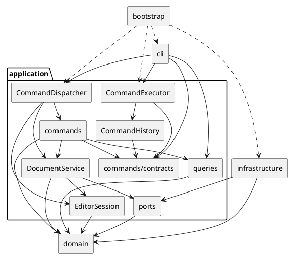

# Lab1 Phase 1：SVG 编辑器（CLI）

本项目使用 TypeScript 实现命令行 SVG 编辑器，支持 `rect`、`circle`、`ellipse`、`line`、`text`、`g` 六种内置图形，以及文档读写、树结构编辑、属性修改、查询和撤销重做。需求依据为 [原作业要求](../phase_cli_1.md)。

运行环境为 Node.js 24 或更高版本，包管理器版本由 `package.json` 的 `packageManager` 固定。安装、构建和启动：

```sh
pnpm install --frozen-lockfile
pnpm run build
pnpm run cli
```

进入后输入 `help` 查看完整语法。简单示例：

```text
init 800 600
create g scene
create rect r1 20 30 120 60 #4a90d9 in scene
create text t1 35 65 "开始" in scene
move scene 40 0
undo
tree
show r1
save demo.svg
```

保存的 SVG 可直接用浏览器打开。完整回放脚本、输出和渲染截图见 [验收记录](acceptance/README.md)。

## 1. 架构方案

### 1.1 目标与范围

以命令组织用户请求，以领域对象维护几何和树结构不变量，以存储端口隔离文件系统和 XML。实现遵守字段封装、类层次、多态、一类一文件，类文件名与类名一致。

本次提交覆盖 Phase 1 的六种内置图形。`box`、动态插件、GUI、宿主集成和通用 EditorApi 不在实现范围内。原方案与实现之间的调整在一致性自查中列出，详细开发记录见 [工作记忆](WORK_MEMORY.md)。

### 1.2 模块划分与职责

| 目录 | 职责 | 主要对象 |
|---|---|---|
| `src/cli/` | 输入分词、REPL、结果排版 | CommandLineParser、Repl、OutputFormatter、ShapeFormatter、TreeFormatter、ShowFormatter |
| `src/application/` | 命令分发、串行执行、会话、历史及文档协调 | CommandDispatcher、CommandExecutor、EditorSession、CommandHistory、DocumentService |
| `src/application/commands/` | 保存请求参数，调用接收者，组织执行及撤销结果 | CreateShapeCommand、MoveShapeCommand、EditChangeSetCommand 等具体命令 |
| `commands/contracts/`、`results/`、`support/` | 命令契约、语义结果、执行守卫与参数支持 | Command、UndoableCommand、CommandResult、CommandExecutionGuard |
| `commands/factories/`、`specs/` | 解码命令参数，构造类型化规格及编辑请求 | CreateShapeCommandFactory、DocumentCommandFactory、ShapeEditCommandFactory、六种 SpecBuilder |
| `src/application/queries/` | 从领域对象生成不可变查询快照 | DocumentViewVisitor、DocumentView、ShapeSnapshot、GeometrySnapshot |
| `src/application/ports/` | 定义应用所需存储契约与导入结果 | DocumentStore、LoadedDocument、ImportedShapeId |
| `src/domain/document/` | 文档聚合、画布尺寸、树结构及 id 不变量、结构变更规划 | SvgDocument、CanvasSize、ShapeTree、ShapeStructurePlanner |
| `src/domain/shapes/` | 叶子与容器行为、样式、属性及精确局部变更 | Shape、ContainerShape、Group、五种叶子图形、ShapeStyle、ShapeAttributeSlot |
| `src/domain/specs/`、`visitor/` | 类型化创建规格与领域遍历协议 | ShapeSpec 及六种规格、ShapeVisitor、ShapeCollector |
| `src/domain/` | 图形集中创建、通用变更契约及失败补偿 | ShapeFactory、ChangeSet、CompositeChangeSet、ChangeSetExecutor、DomainError |
| `src/infrastructure/` | SVG 解析、序列化和文件存储适配 | SvgTreeParser、SvgElementFactory、SvgReader、SvgWriteVisitor、SvgDocumentStore |
| `src/bootstrap/` | 组装依赖并启动 CLI | Main、entry |
| `tests/` | 领域、应用、CLI、集成与端到端测试及样本 | 分层测试、support、fixtures |
| `scripts/`、`doc/` | 构建清理、项目说明及验收证据 | clean.mjs、本文件、验收记录 |

`commands/` 下的子目录均属于应用层。各层不通过 barrel 文件隐藏依赖；生产类独立成文件。`SvgDocument` 持有私有树和规划器，对外提供受控领域操作；图形仅开放只读父子查询。

### 1.3 模块关系图

箭头指向被依赖的模块，虚线表示启动装配。命令执行器与历史只依赖命令契约，不依赖具体命令类。



### 1.4 设计模式的选择与落地

| 模式或手段 | 实际落地 | 选择理由与取舍 |
|---|---|---|
| Command | `Command` 统一执行入口；`UndoableCommand` 增加撤销、重做；具体命令持有参数及接收者；`CommandExecutor` 协调执行和历史 | 请求可独立测试，执行入口统一；命令不直接修改树集合、维护索引或读写文件 |
| Composite | `Shape` 统一几何和属性契约，`ContainerShape`、`Group` 组合子图形；move/scale 递归准备后代变更 | 叶子和容器通过相同命令操作；删除及重挂接由文档聚合统一维护不变量，普通组的 set 仅修改自身样式 |
| Visitor | `ShapeVisitor`、各图形的 `accept`、`DocumentViewVisitor`、`SvgWriteVisitor`、`ShapeCollector` | 遍历与查询、序列化职责分离；Group 控制递归，访问者可跳过子树。适合固定六类型，新增类型需复评协议 |
| Adapter | `SvgDocumentStore` 实现 `DocumentStore` | 文件系统及 XML 库留在基础设施，应用通过端口使用存储 |
| Iterator | 根节点和容器通过 `Iterable<Shape>` 提供有序遍历 | 隐藏可变集合，避免暴露 children 的增删入口 |
| 简单工厂与静态注册 | 命令定义表、`ShapeFactory`、读取方向的 `SvgElementFactory` | 名字分派集中；帮助与命令语法同源，不提前实现动态加载 |

按名字分派限定为命令分发和图形工厂两类位置：`CommandDispatcher` 负责命令名，`CreateShapeCommandFactory` 负责 create 子命令规格，`ShapeFactory` 负责类型化规格到图形类，`SvgElementFactory` 负责 SVG 标签到解析节点。它们是后续增加命令或图形时的集中重构点；领域操作和 CLI 排版不散布图形名称 switch。

### 1.5 命令执行与职责边界

```text
输入行 → 分词 → CommandDispatcher 创建命令
      → CommandExecutor 串行执行
      → 具体命令调用 SvgDocument / DocumentService
      → 返回语义结果 → CLI 排版
```

命令参数工厂将 token 解码为类型化创建规格、数值或属性更新，领域不解析外部命令语法。预期错误通过执行守卫转换为失败结果，未知异常由执行器输出统一错误并保留内部 cause。应用结果只表达语义，`error:` 前缀、属性布局和树形字符由 CLI 负责。

编辑命令绑定文档并保存局部变更。查询访问者捕获几何、样式、父级和子节点，返回复制并冻结的快照；CLI 不持有可写领域对象。`DocumentService` 协调会话和 IO，不管理历史；执行器在文档命令成功后建立历史屏障。

### 1.6 撤销重做与失败原子性

一条成功且有状态变化的编辑命令构成一个 undo 单元。历史保存命令及局部 `ChangeSet`，不复制无关文档数据。几何保存精确前后值；属性保留原值及是否存在；结构变更保留节点、父级和位置。redo 重用首次记录，撤销不依赖反向浮点运算。

| 操作 | 历史行为 |
|---|---|
| 新的有效编辑 | 压入 undo，清空 redo，解除屏障 |
| undo / redo | 状态恢复及结果构造成功后迁移命令 |
| 查询、无参数 canvas | 不改变历史 |
| init / read / save / 修改 canvas | 成功后清空旧历史并建立屏障 |
| 成功但无状态变化的编辑 | 不入历史，保留 redo 和原屏障状态 |
| 失败命令 | 文档、默认路径、历史栈和屏障保持不变 |

领域先准备并校验所有候选变更，再同步提交。多节点操作不边计算边修改；组合变更逆序撤销，提交或恢复失败时补偿已完成的动作。结果构造失败同样恢复状态。

read 先解析、构造并验证候选文档，成功后替换会话；警告只在读取成功后返回。save 先写同目录临时文件，再 rename 替换目标，成功后更新路径。真实文件故障注入验证了临时文件创建、部分写入及替换失败时的保留与清理行为；不将此等同于进程崩溃或断电恢复保证。

### 1.7 依赖方向规则

| 模块或对象 | 允许依赖 | 理由 |
|---|---|---|
| domain | 标准能力和领域内部模块 | 领域规则不绑定终端、文件系统或 XML 库 |
| commands/contracts | 必要的内部命令与结果契约 | 供执行器和历史稳定调用 |
| commands/results | 命令契约、只读查询模型 | 传递语义结果，隔离展示 |
| commands/support | 契约、结果、领域错误和端口错误 | 集中处理命令边界 |
| 具体命令 | 契约、结果、支持类、domain、DocumentService、查询模型 | 编排用例，业务校验留在接收者 |
| EditorSession、ports | domain | 保存领域状态，定义存储需求 |
| DocumentService | EditorSession、ports、domain | 协调文档，不接触具体存储实现或历史 |
| queries | domain 和查询模型 | 生成只读投影 |
| CommandExecutor、CommandHistory | 命令契约；执行器另依赖历史 | 避免与具体命令互相依赖 |
| CommandDispatcher | 命令及创建器、会话、文档协调与历史、查询协作者 | 集中装配命令请求 |
| cli | 应用入口、结果契约、查询模型、终端能力 | 只承担交互和排版 |
| infrastructure | ports、domain、必要的 Node.js/XML 库 | 实现外部能力适配 |
| bootstrap | 所需生产模块 | 集中创建对象和注入依赖 |
| tests | 被测模块和测试工具 | 测试依赖生产，生产不依赖测试 |

禁止反向依赖和运行期循环；其他生产模块不得依赖 bootstrap。仅用于类型的导入使用 `import type`，避免图形与 Visitor 的类型引用形成运行期加载环。

### 1.8 变化点假设与扩展取舍

| 变化点 | 已保留的边界或不预留的原因 |
|---|---|
| 新命令 | 定义表统一注册语法和创建逻辑，可复用执行器、历史及局部变更基类 |
| 新图形、box 与插件 | 工厂集中创建、Composite 支持组合；当前不加载插件，任意新类型需复评 Visitor、序列化和历史契约，不承诺零内核改动 |
| GUI | 命令、领域和只读投影可复用；命中检测、拖拽预览及视口尚无实际需求，不预设协议 |
| 宿主集成 | 存储端口可适配宿主；历史归属和通信方式由实际宿主决定，当前不绑定 SDK |
| 统一 EditorApi | 当前仅 CLI，第二入口未定；不提前增加转发层、通用请求和订阅协议 |
| XML 库和存储实现 | 由读取/写入适配器与 DocumentStore 隔离，替换时验证端口契约 |
| 历史规模 | 局部记录按受影响范围增长；有性能证据后再设计容量和持久化 |

### 1.9 已明确的实现边界

- id 全局唯一且大小写敏感；CLI 创建必须显式指定，外部读取缺 id 才自动编号。先收集所有显式 id，再分配缺失项，避免占用后续显式名称。
- 跨父级 group 挂到最近公共祖先末尾，组内按参数顺序排列；禁止同时选择祖先及其子孙。ungroup 拒绝根级容器；addto 禁止形成环。
- front 对应同级数组末尾、视觉最前；back 对应数组开头。已在目标位置时不产生历史记录。
- scale 同乘位置与尺寸；text 仅缩放 x、y，不引入 font-size。普通组的样式保留 SVG 继承语义，不覆盖子孙显式样式。
- SVG 读取仅接受六种图形、标准命名空间和已建模属性。DOCTYPE、处理指令、transform、style、class、defs、未知元素或属性、text 子元素均拒绝，避免保存时静默丢失内容。
- 画布宽高为正有限数；viewBox 可省略，存在时必须等价于 `0 0 width height`。文件按 UTF-8 读取，其他显式编码声明拒绝。
- 成功 read 或带路径 save 更新默认路径，init 清空默认路径；无参数 save 使用当前默认路径。元素计数不包含 svg 根，包含所有组和后代。
- help、init、read 可作为无文档入口；其他命令要求当前文档。只有行首 # 为注释，颜色中的 # 保留；双引号支持含空格参数。

## 2. 过程记录

以下记录来自实际讨论、代码检查和验证，按问题与修正组织。完整开发记录见 [WORK_MEMORY](WORK_MEMORY.md)。

| 讨论或发现 | 确认方式 | 处理与取舍 |
|---|---|---|
| AI 建议为每次编辑保存全文快照，小编辑也复制无关对象 | 对照复杂编辑的撤销需求和对象职责 | 改为命令持有局部 ChangeSet，精确记录几何、属性存在性和树位置 |
| 提前引入 EditorApi 和纯转发 Service，实际只有 CLI | 用户审查接口用途与职责 | 不实现通用 API；命令直接委托领域，保留会话、历史、执行器及 IO 协调 |
| 领域解析 CLI token、空字符串被 Number 转成 0 | 源码审查及空数字、十六进制回归 | 用类型化 Spec 和属性更新隔离外部语法，数值解码集中在命令参数层 |
| 公开树写入口可绕过索引和防环约束 | 检查 children、parent 与 id 索引的修改路径 | 删除公开 symbol 写协议，由文档私有 ShapeTree 维护结构，规划器只准备变更 |
| 查询和展示存在多套 View、Visitor 与重复投影 | 对照调用链、依赖和实际用途 | 合并为统一不可变快照，CLI 共用 ShapeFormatter；保留领域 Visitor |
| readonly 不能阻止运行期集合修改，明细可能过度遍历 | 快照冻结、领域隔离及不访问子节点回归 | 防御性复制并冻结集合和元组；单独非递归 Visitor 生成明细 |
| 结构、历史和查询薄工厂及集合继承重复 | 检查各类是否提供独立行为 | 删除薄工厂和 TreeEditCommand，复用 EditChangeSetCommand 与 CompositeChangeSet |
| 容器移动 undo 摘要使用了正向增量 | 两个回归先失败，再核对典型会话与流程图 | 在 MoveShapeCommand 结果构造处携带反向位移，精确几何恢复方式保持一致 |
| 保存失败需要验证旧文件及会话完整状态 | 真实旧文件上注入创建、部分写入和 rename 失败 | 检查旧内容、临时文件清理、路径、树、历史与 redo，记录保证范围 |
| 提交文档仍混有早期待实现说明 | 对照作业规定的四项文档内容和当前源码 | 整理为提交版说明，保留设计变更、自查及真实验收依据，移除日期与时间标记 |

## 3. 一致性自查

### 3.1 模块划分是否一致

五个主要模块与分层方案一致，内部协作有以下调整；未将这些实现变化描述为原方案一直如此。

| 原方案或中间设计 | 实际实现 | 调整理由 |
|---|---|---|
| SvgDocument 直接承担树维护与结构规划 | 聚合根持有私有 ShapeTree 和 ShapeStructurePlanner | 分离索引维护和候选规划，收紧树写入口 |
| 容器通过透明式结构接口操作子节点 | 图形仅查询父子关系，结构写操作由文档聚合负责 | 避免叶子/容器公开写入口绕过文档不变量 |
| 六类查询 View 和查询展示 Visitor | DocumentView、ShapeSnapshot、GeometrySnapshot、一个投影 Visitor，CLI 共用 Formatter | 减少平行层次和重复分派，查询结果仍为不可变语义数据 |
| 多个薄命令工厂与树编辑中间基类 | 保留三类有解码职责的工厂；简单命令直接由 Dispatcher 创建，结构命令复用 EditChangeSetCommand | 去除无独立行为的转发层 |
| 树、属性、几何分别维护组合变更集合 | CompositeChangeSet 统一组合契约，GeometryChangeSet 保留便利构造 | 去除重复提交和补偿逻辑 |

上述变化未改变四层职责、Command、Composite、局部历史和 IO 隔离。详细调整及验证事实均保存在工作记忆中。

### 3.2 依赖方向是否符合规则

| 抽查对象 | 实际依赖与结论 |
|---|---|
| SvgDocument、ContainerShape | 仅依赖领域协作者；无终端、文件系统、XML 或 CLI token |
| CommandHistory、CommandExecutor | 通过命令契约执行及迁移历史，不依赖具体编辑命令 |
| MoveShapeCommand、EditChangeSetCommand | 委托领域变更并构造语义结果；不维护树集合、不拼接 CLI 文案 |
| DocumentViewVisitor、ShapeFormatter | 投影依赖领域，排版依赖应用快照；无反向调用 |
| SvgDocumentStore、SvgElementFactory | 基础设施依赖存储端口和领域，外部 XML 类型未进入领域 |
| Main | 集中组装具体实现，无其他生产模块反向导入 bootstrap |

自动架构守卫检查领域隔离、层级依赖、运行期循环、一类一文件、字段封装、集中分派及命令变更入口。结合源码抽查，未发现当前范围内待修正的依赖违规。领域校验仍封装于对象，查询快照仅传递不可变结果；未引入 box、插件加载或隐式字符串扩展协议。

## 4. 质量保证手段

### 4.1 验证方法与覆盖

采用分层测试和问题驱动回归。新增功能先固定输入、结果和状态约束；修复问题时用失败用例确认，再修改实现并运行回归。复杂操作同时检查父级、顺序、id 索引、几何、文本和属性存在性，不能只比较成功提示。

| 验证层级 | 主要覆盖 |
|---|---|
| 领域单元 | 六种图形、样式与几何校验、Composite、防环、顺序、局部变更及补偿 |
| 应用与命令 | 参数构造、串行执行、查询快照隔离、有效编辑入栈、undo/redo、屏障和失败不迁移历史 |
| CLI | 分词、双引号、颜色、数值、单行错误、help、tree/show 与交互/管道提示符 |
| IO 集成 | 严格读取、命名空间、缺 id、XML 转义、默认路径、round-trip、真实文件故障注入 |
| 端到端 | 构建生产入口并启动 Node CLI，逐字比较需求典型会话与版本 A 流程图的输出和 SVG |
| 架构守卫 | 依赖方向、循环、字段封装、一类一文件、Command 变更入口及分派位置 |
| 浏览器观察 | Edge 无头渲染并实际查看两个 SVG 的几何、颜色、文字与布局 |

失败用例统一检查文档、默认路径、undo/redo 和屏障不变；读取失败不输出部分警告。测试按 domain、application、cli、integration、e2e 和 support 组织，具体需求映射见 [测试清单](../tests/README.md)。

### 4.2 实际结果与复现

严格类型检查通过；自动化套件共 **31 个测试文件、96 个测试通过**；清理后的生产构建通过。测试清单共 140 项：137 项通过、3 项因 box/插件不在范围内标为 N/A。清单项与自动化测试不是一一对应关系，不把 137 项写成独立测试数量。

在仓库根目录可运行：

```sh
pnpm run check
```

已安装依赖的 Windows 环境中，本次实际验证直接调用本地工具，避免 pnpm 启动器的用户缓存权限问题：

```powershell
node_modules/.bin/tsc.cmd --noEmit
node_modules/.bin/vitest.cmd run
node scripts/clean.mjs
node_modules/.bin/tsc.cmd -p tsconfig.build.json
```

验收样本及完整输出位于 [tests/fixtures/acceptance](../tests/fixtures/acceptance/)，[验收记录](acceptance/README.md) 给出回放和浏览器渲染方法。典型会话验证缺 id 警告和 7 元素读入；流程图验证 8 元素、嵌套组、中文及移动撤销。终端对齐空格采用固定列宽，线段额外显示显式 stroke，启动提示使用 ASCII 连字符；这些展示差异已记录。

浏览器截图来自已完成的 Edge 本地渲染与实际观察，见 [demo](acceptance/demo.png) 和 [flowchart](acceptance/flowchart.png)。证据不代表跨浏览器测试或用户亲自验收。文件故障注入不包含断电恢复验证；依赖漏洞审计未作为本次验证结果。

### 4.3 Git 交付状态

仓库保留分步开发历史。当前源码、测试、样本和文档留在工作区供检查；本次整理未暂存、提交、推送或创建 `final` tag。用户提供提交信息后才执行提交，确认检查完成并要求推送后才推送；最终验收确认后按明确指令创建 `final` tag。
