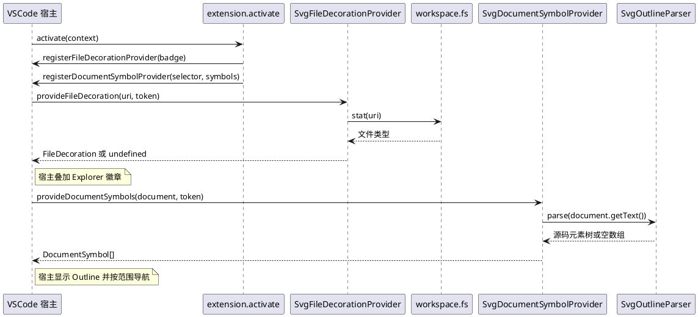
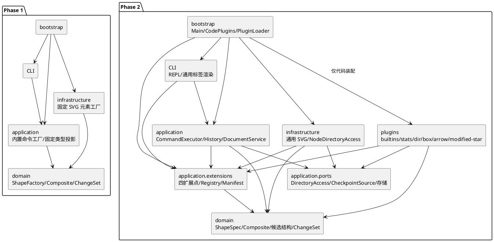

# Lab1 Phase 2 实验报告：插件实践与插件式重构

## 1. 实验目标与交付范围

本实验包括 VSCode 扩展实践和 SVG CLI 插件式重构。扩展提供 SVG 文件标记与原生大纲；CLI 开放图形、命令、树标签和属性四个扩展点，新增 stats、dir、box、modified-star 和选做的 arrow 插件，支持代码和配置两种装配方式。

| 交付内容 | 仓库位置 |
|---|---|
| VSCode 扩展、清单与示例 | [extensions/svg-tools](../extensions/svg-tools)、[scene.svg](../extensions/svg-tools/examples/scene.svg) |
| CLI 内核、接口、插件与装配 | [src](../src)、[扩展接口](../src/application/extensions)、[插件包](../src/plugins)、[组合根](../src/bootstrap) |
| 配置与纯命令会话 | [plugins.config.json](../plugins.config.json)、[box 会话](resources/transcript/box.txt)、[新增命令会话](resources/transcript/plugins.txt) |
| 架构决策 | [ADR 目录](adr)，本报告第 7 节 |
| Git 历史指标及脚本 | [docs/metrics](../docs/metrics)、[metrics.mjs](../scripts/metrics.mjs) |
| 验证证据 | [CLI 完整检查](resources/cli/phase2/check.txt)、[CLI 验收](resources/cli/phase2/validation.txt)、[宿主结果](resources/vscode/host-results.json) |

## 2. 第一部分：VSCode 插件实践

本部分介绍扩展的运行方式、宿主协作、模式分析及 Phase 1 代码复用取舍。扩展向 Explorer 和原生 Outline 提供数据，不修改文件名或内容。

### 2.1 功能与源码组织

文件标记功能在 Explorer 中为 SVG 文件附加 `[]`，普通文件和目录不标记。大纲功能展示 SVG 根元素、容器及叶子的源码层级；有 id 显示为 `标签名#id`，无 id 仅显示标签名。选中节点由宿主定位到源码，修改未保存文本后重新生成大纲；XML 不完整时返回空结果，合法输入恢复后可重新显示。

| 材料或模块 | 位置与职责 |
|---|---|
| 扩展清单 | [package.json](../extensions/svg-tools/package.json)：激活事件、入口、最低宿主版本与默认编辑器关联 |
| 激活入口 | [extension.ts](../extensions/svg-tools/src/extension.ts)：创建两个 provider，注册功能并交付资源生命周期 |
| 文件装饰 | [SvgFileDecorationProvider](../extensions/svg-tools/src/SvgFileDecorationProvider.ts)：判断文件类型，返回装饰并通知失效 |
| 大纲适配 | [SvgDocumentSymbolProvider](../extensions/svg-tools/src/SvgDocumentSymbolProvider.ts)：把源码元素转换为宿主 DocumentSymbol/Range |
| 源码解析与模型 | [SvgOutlineParser](../extensions/svg-tools/src/outline/SvgOutlineParser.ts)、[SvgOutlineElement](../extensions/svg-tools/src/outline/SvgOutlineElement.ts)：保存任意元素层级、显示名与 UTF-16 源码偏移 |
| 示例 | [scene.svg](../extensions/svg-tools/examples/scene.svg)、[UPPER.SVG](../extensions/svg-tools/examples/UPPER.SVG)、[notes.txt](../extensions/svg-tools/examples/notes.txt)、[folder.svg 目录](../extensions/svg-tools/examples/folder.svg) |
| 启动与打包 | [.vscode/launch.json](../.vscode/launch.json)、[构建脚本](../scripts/build-extension.mjs)、[打包脚本](../scripts/package-extension.mjs) |

scene.svg 含嵌套 g、带 id 的 rect/text/path，以及无 id 的 text/circle，可同时验证层级、缺省显示名和超出 Phase 1 六类型的元素。

### 2.2 VSCode 与插件的职责及调用过程

#### 职责划分

| VSCode 宿主负责 | 本扩展负责 |
|---|---|
| 管理工作区、URI、文件访问和文件变化事件 | 判断 URI 是否为 SVG 文件，将判断结果转换为 FileDecoration |
| 创建 Explorer 文件项并渲染徽章 | 返回 `[]` 和说明文字，不重命名文件、不绘制文件项 |
| 管理 TextDocument、未保存缓冲区和编辑后的符号查询 | 读取当前 getText()，解析层级并返回 DocumentSymbol 树 |
| 绘制 Outline，处理展开、排序、选择和源码导航 | 提供整体 range 与定位 selectionRange，不接管点击处理 |
| 管理文本修改、撤销及扩展停用时的资源释放 | 将注册句柄、watcher、事件订阅等 Disposable 放入 context.subscriptions |

#### 注册阶段

清单通过 `onStartupFinished` 激活扩展，使用户仅浏览 Explorer 时也能看到标记。宿主加载打包后的 `dist/extension.cjs` 并调用 `activate(context)`。入口实例化 SvgFileDecorationProvider，建立文件监听，再注册两个能力：

```ts
const decorations = new SvgFileDecorationProvider();
decorations.watch(context.subscriptions);
context.subscriptions.push(
  window.registerFileDecorationProvider(decorations),
  languages.registerDocumentSymbolProvider(
    [{ pattern: '**/*.[sS][vV][gG]' }], new SvgDocumentSymbolProvider()
  )
);
```

注册后由宿主在需要时调用 provider，形成控制反转。

#### 文件标记与大纲查询



文件装饰先检查取消状态及大小写无关 `.svg` 后缀，再调用 `workspace.fs.stat` 确认 File 位。目录即使名为 folder.svg 也返回 undefined；文件消失或访问失败也返回 undefined，不影响 Explorer。符号链接仅在宿主 stat 同时报告 File 位时标记，不递归解析其目标。watcher 在创建、改变、删除时触发 onDidChangeFileDecorations，通知宿主重新查询。

大纲 provider 每次读取当前缓冲区，不从磁盘取代未保存内容。解析器构建带范围的 SvgOutlineElement，provider 用显式工作栈转换整棵树，避免深层转换耗尽调用栈。range 覆盖整个元素，selectionRange 指向开标签名；UTF-16 偏移经 TextDocument.positionAt 转成宿主坐标。无效 XML 返回空树，不保留部分结果或旧缓存，也不补写 id。

源码导航还取决于宿主对 SVG 的默认编辑器选择。用户实测曾发现 Outline 导航进入图片预览，因此清单通过 configurationDefaults 提供 SVG → Text Editor 的默认关联。显式用户/工作区关联仍可覆盖默认值；扩展不运行 update 修改用户配置，也不增加点击拦截或反复切换编辑器的监听器。

### 2.3 文件装饰与 Decorator、Adapter 模式分析

#### 与经典 Decorator 的对应及差异

文件装饰的效果是给原有 Explorer 文件项追加徽章，原文件名和内容不变，这与 Decorator 的“附加职责”目标相似。但经典 Decorator 通常要求装饰器和被装饰对象实现同一 Component 接口，装饰器持有该对象，并转发原操作后增加行为。

SvgFileDecorationProvider 实现 FileDecorationProvider，只返回装饰数据，由 VSCode 将徽章叠加到文件项。它不实现文件项接口，也不持有或转发被包装对象，因此属于宿主装饰扩展机制，而非完整的经典 Decorator 包装链。

#### 与 Adapter 的对应及对象组合

Adapter 关注把已有能力转换成调用者要求的接口。文件装饰类把 URI/文件元数据转换为宿主所需装饰结果，大纲 provider 则把独立源码模型转换为宿主符号模型；两者均通过实现接口和组合协作者完成转换，而不是继承宿主 UI。

| 角色 | 文件装饰中的对应 | 大纲中的对应 |
|---|---|---|
| Client | VSCode 的 Explorer 装饰查询 | VSCode 的文档符号与 Outline 服务 |
| Target | FileDecorationProvider.provideFileDecoration | DocumentSymbolProvider.provideDocumentSymbols |
| Adapter | SvgFileDecorationProvider | SvgDocumentSymbolProvider |
| 被适配能力/数据 | workspace.fs.stat 提供的文件元数据 | 组合的 SvgOutlineParser 及其 SvgOutlineElement 树 |
| 转换结果 | FileType → FileDecoration 或 undefined | 元素名/children/偏移 → DocumentSymbol/children/Range |

文件装饰将文件元数据转换为宿主装饰结果。大纲的对象适配更直接：provider 组合 parser，把不依赖 VSCode 的解析结果转换为宿主 API 类型；迁移到其他宿主时可替换适配层。

Decorator 描述附加职责，Adapter 描述接口转换，控制反转描述调用方向。

### 2.4 Phase 1 解析、模型与遍历代码的复用评估


| Phase 1 模块或经验 | 能否直接复用 | 原因与本次做法 |
|---|---|---|
| saxes XML 库、事件式解析和栈组织经验 | 库可复用，解析策略可借鉴 | 已能处理命名空间、注释、实体等 XML 语法；本次复用依赖，以独立 SvgOutlineParser 记录源码偏移 |
| SvgTreeParser、SvgElementFactory、SvgAttributes | 不直接复用 | 原实现限制六种元素及属性，并验证画布等编辑约束；普通 path/defs 或扩展属性不应使源码大纲失效，且原结果没有完整定位信息 |
| SvgReader、MissingIdAllocator | 不复用 | 读取会校验全局 id、为缺失 id 分配名字并构建领域文档；大纲应保留无 id 显示与源文本语义，不需要创建可编辑对象 |
| SvgDocument、Shape/Group 领域模型 | 不复用实体类，借鉴树结构组织 | 领域对象保存几何、样式及编辑关系，不保存原始元素的起止范围，也不覆盖任意 SVG 标签；本次使用轻量 SvgOutlineElement 保存语法层级 |
| ShapeVisitor、ShapeCollector、DocumentViewVisitor | 不直接复用，借鉴统一遍历 | Phase 1 Visitor 面向六种领域类型及编辑树，不能直接遍历任意源码元素。新的适配过程统一处理所有元素，并用显式工作栈生成宿主树 |
| Command、undo/redo 和 CLI 输出排版 | 本功能不复用 | 本扩展只查询；文本编辑与撤销、Outline UI 均由 VSCode 管理，引入 CLI 历史或终端格式不会提供必要能力 |

若将 Phase 1 解析器扩成兼顾范围与任意元素的公共语法层，理论上可供两种入口复用，但这需要先拆开严格编辑导入和源码展示的职责，增加接口及回归成本。本实验只复用 saxes 和解析经验，不让独立扩展依赖 CLI 各层。代价是两套解析策略需要分别维护，每次大纲请求完整解析，未实现增量解析。取舍见 [ADR-001](adr/001-vscode-source-outline.md)。

### 2.5 安装、启动与演示步骤

需要 Node.js ≥24、仓库固定版本 pnpm、桌面 VSCode ≥1.96。在仓库根目录执行：

```sh
pnpm install --frozen-lockfile
pnpm run check:extension
```

开发启动：用 VSCode 打开整个仓库，按 F5 选择 **SVG Tools: Extension Host**。preLaunchTask 自动构建，调试配置打开示例目录。检查 scene.svg、UPPER.SVG 的 `[]`，对照 notes.txt 和 folder.svg 目录没有标记；打开 scene.svg，展开原生 Outline 的 svg → g#flow → g#labels，点击 rect#start 应定位到源码第 3 行。修改 id 后检查更新，暂时删去闭合标签检查空大纲，再撤销以检查恢复，演示后不保存临时修改。

打包安装：

```sh
pnpm run build:extension
pnpm run package:extension
code --install-extension extensions/svg-tools/dist/svg-tools-0.1.1.vsix --force
```

也可通过扩展视图的 **Install from VSIX...** 安装。esbuild 把扩展与 saxes 打包成独立 CJS，vscode 模块由宿主提供；安装者无需安装本仓库的 node_modules。升级后执行 **Developer: Reload Window**。已打开的图片预览可用 **Reopen Editor With... → Text Editor** 返回源码；若显式用户关联仍指定图片编辑器，应将其 SVG 对应项改为 default。仅临时重开一次不等于改变之后导航使用的默认关联。

自动化入口：

```sh
pnpm run test:extension
pnpm run typecheck:extension
pnpm run test:extension:host
```

宿主测试默认可下载 VSCode；本地已有安装时，可在 PowerShell 指定实际可执行路径：

```powershell
$env:VSCODE_EXECUTABLE_PATH = "$env:LOCALAPPDATA\Programs\Microsoft VS Code\Code.exe"
pnpm run test:extension:host
```

示例路径需按实际安装位置调整。宿主测试使用隔离的临时配置，不修改日常 VSCode 配置。

### 2.6 截图与验证证据

实际运行截图：


图中 scene.svg、UPPER.SVG 显示 `[]`，notes.txt 与 folder.svg 目录未标记；`U` 是 Git 未跟踪状态，不是本扩展的徽章。Outline 包含嵌套 g、带 id 的节点及无 id 的 text/circle。选中 rect#start 时右侧为 Text Editor，第 3 行高亮，状态栏为 Ln 3, Col 5。此图为本项目实际证据，不使用作业说明中的示意图代替运行结果。

| 验证内容 | 证据及结论 |
|---|---|
| 标记、目录排除、文件名和内容保持 | 实际截图及宿主 file-badges、directory-exclusion、unchanged-files 检查通过 |
| 嵌套、无 id、源码范围及导航 | 实际截图及 nested-symbols-and-navigation 检查通过 |
| 未保存编辑后的更新 | 宿主 unsaved-edits 检查通过 |
| 不完整 XML 与恢复 | 宿主 incomplete-xml-recovery 检查通过 |
| 默认编辑器、显式图片预览及大写后缀导航 | source-editor-resolution、explicit-image-preview、uppercase-source-navigation 检查通过 |

[host-results.json](resources/vscode/host-results.json)记录已执行的 VSCode 1.148.0 宿主结果；[validation.txt](resources/vscode/validation.txt)保存当时检查日志；[outline-navigation.txt](resources/vscode/outline-navigation.txt)记录导航问题修复前后的输出。静态截图证明界面状态，API 回归证明对应自动化路径，不将其外推为完整手工连续操作的录像或截图。

| 尚未补充的手工动态验证 | 结果 | 截图 |
|---|---|---|
| 修改 id → 不完整 XML → 撤销恢复的连续操作 | | |

手工动态证据尚未补充；最低宿主版本 1.96、其他操作系统和远程工作区尚未验证。上述宿主结果来自已有记录，本次未重跑 GUI 或打包安装。

## 3. 第二部分：CLI 架构重构

### 3.1 原设计、变化点与实际调整

Phase 1 是固定六类型编辑器，Command 和 Composite 已承担命令历史及图形树操作，但内置命令工厂、创建、查询投影和 SVG 元素工厂需要共同覆盖固定类型。直接加入 box 会要求多处同步修改；属性与树输出也缺少独立扩展入口。

本阶段把变化分为四类：ShapeProvider 提供类型创建与编解码，CommandContribution 注册命令，AttributeHandler 准备属性变更，TreeDecorator 提供行尾标签。应用只查询目录并调用契约；按名称选择实现集中于命令分发、创建与 SVG 元素工厂。领域接收类型化规格，不接收 XML 或终端 token。

实际调整还包括通用 ShapeVisitor、ShapeSpec.create 多态构造、完整子树与最终候选结构校验。这些框架能力先于正式 box 接入；测试用 guarded 容器未被记作已交付 box。

### 3.2 模块职责与依赖规则

| 模块 | 职责 | 允许的项目内依赖 |
|---|---|---|
| domain | 图形/容器、规格、文档聚合、不变量、局部 ChangeSet 与补偿 | domain |
| application | 分发/执行/历史、会话、文档服务、查询、端口、扩展契约与注册事务 | application、domain |
| cli | 分词、REPL、语义结果与标签排版 | cli、application |
| infrastructure | SVG/XML、原子文件存储、Node 目录适配 | infrastructure、application、domain |
| plugins | builtin-commands、builtin-shapes、stats、dir、shape-box、shape-arrow、modified-star | 自身插件包、公开应用/领域契约 |
| bootstrap | Main、CodePlugins、PluginLoader，实例化服务并选择装配 | 各层，作为组合根 |
| extensions/svg-tools | 独立 VSCode 扩展 | 宿主 API、自身大纲模型、saxes；不依赖 CLI |

插件不得导入内部 ShapeTree、结构规划器、候选关系写实现或宿主装配。领域不依赖文件系统、终端、XML 或应用层。[架构守卫](../tests/integration/architecture.test.ts)固定依赖范围，不能把所有 export 都当作公共 API。

### 3.3 重构前后模块依赖图（PlantUML）



### 3.4 设计模式与原则

| 模式或原则 | 落地与作用 |
|---|---|
| Command | CommandExecutor 串行执行；EditChangeSetCommand 统一准备、提交、撤销/重做及结果失败补偿，一次编辑一个历史单元 |
| Composite | Shape/ContainerShape 统一操作，move/scale 作用于后代；box 可嵌套、入组，子树创建/删除整体撤销 |
| Adapter | DirectoryAccess 隔离 Node 目录 API；VSCode provider 将源码模型转换成宿主符号及范围 |
| 策略与注册表 | provider、handler、标签以类实例实现契约，帮助与命令目录同源 |
| 装饰扩展 | TreeDecorator 为渲染行追加职责；并非包装同一 Component 接口的经典 Decorator 链 |
| OCP、依赖倒置 | 框架依赖内核侧接口，业务新增依靠实现及装配；Git 接入差异证明边界 |

## 4. 四个扩展点清单

接口位于 [application/extensions](../src/application/extensions)，Command 抽象位于 [commands/contracts/Command.ts](../src/application/commands/contracts/Command.ts)。下表给出当前文件与函数名，供源码核验。

| 接口与职责 | 实际调用位置 | 实现 | 禁用可选插件后的行为 | 契约违反处理 |
|---|---|---|---|---|
| ShapeProvider：语法、规格、投影、SVG 编解码及导入校验 | plugins/builtin-commands/factories/CreateShapeCommandFactory.ts / createSpec；application/queries/DocumentViewVisitor.ts / inspect、visitSubtree；infrastructure/SvgWriteVisitor.ts / element；SvgElement.ts / decode；DecodedSvgElement.ts / validate | builtin-shapes 六个 provider；BoxProvider、ArrowProvider | 六类型保留；box/arrow 报 unknown shape type；未知 data-kind 的 g 降级普通 g | 非法元数据拒绝注册；规格身份/id/type、SVG 输出非法报错；不完整复合拒绝候选文档 |
| Command / CommandContribution：命令实现、名称、帮助语法 | application/CommandDispatcher.ts / create；CommandExecutor.ts / execute、run；HelpCommand 读取目录 | builtin-commands；StatsCommand；DirCommand | 原命令保留；stats/dir 报 unknown command 且不显示在 help | 重名拒绝插件；工厂/执行异常转错误；编辑实现须遵守统一事务 |
| TreeDecorator：返回画布或节点行标签 | cli/TreeFormatter.ts / decorate、format、formatSubtree | BoxTypeDecorator；ModifiedStarDecorator | 无额外标签，tree 与 final 字节一致 | 非数组、非文本、多行标签拒绝；REPL 返回 tree decoration failed，文档/历史保持 |
| AttributeHandler：属性的领域语义 | plugins/builtin-commands/factories/ShapeEditCommandFactory.ts / createSet；application/extensions/AttributeResolver.ts / prepare；SetShapeAttributeCommand.ts / prepareChange、createResult | BoxAttributeHandler 的 fill、label | 零匹配走原白名单，rect.fill 有效，未知 label 报 unknown attribute | 多匹配报 ambiguous attribute handler；非法准备结果拒绝；失败不回退默认，组合变更补偿，历史保持 |

注册、调用和缺省路径由注册测试、[独立插件测试](../tests/plugins)、集成测试和禁用插件的基线回放分别验证。provider 查询/编码、handles 和 prepare 必须只读；框架不能恢复违约插件任意产生的外部副作用。

## 5. 插件实现与领域语义

### 5.1 stats 图形统计

[stats 包](../src/plugins/stats)独立于 builtin-commands。StatsContribution 提供名字、无参数规则与帮助；StatsCommand 读取 DocumentView，StatsPresenter 按当前顺序深度优先遍历。叶子按逻辑类型计数，类型保留首次出现顺序；g/box 只计 containers，根不计，box 内部 rect/text 仍计为叶子。空文档输出 (total 0, containers 0)。该命令不入历史、不清 redo。

### 5.2 dir 与目录访问适配器

[dir 包](../src/plugins/dir)只依赖 [DirectoryAccess](../src/application/ports/DirectoryAccess.ts)，不导入 node:fs。接口提供 currentPath() 与 entries(path)，不可变 DirectoryEntry 表达目录项。

| Adapter 角色 | 对象 | 职责 |
|---|---|---|
| Client | DirCommand | 获取 cwd 并请求直接项，不依赖 Node API |
| Target | DirectoryAccess | 插件需要的抽象，可由测试替身实现 |
| Adapter | NodeDirectoryAccess | 把 readdir/Dirent 转成 DirectoryEntry |
| Adaptee | node:fs/promises.readdir、Dirent | 真实文件系统能力 |

目录优先，各组按名称 Unicode 码元升序稳定排列；保留隐藏项、不递归、不列 . 和 ..。符号链接和特殊项按 FILE 展示，不跟随目标。空目录输出 (empty directory)，失败输出 error: cannot read directory: `<path>`。cwd 是进程目录，read/save 不改变它；dir 无需文档，也不改变内容、dirty、路径和历史屏障。

替身覆盖混合项、隐藏项、空目录、失败及排序，真实临时目录验证适配器与命令组合。两种装配注入同一接口和实现，不另写配置版 IO。

### 5.3 属性扩展契约与原子性

初始 handles(shapeId, attr)/apply 接口不足以表达事务，最终协作为：

1. handles 接收只读 ShapeSnapshot，以 kind/id 判断是否负责，不暴露内部树写入口。
2. AttributeEditContext 仅提供 prepareSet、readAttribute；prepare 返回包含 ChangeSet 与 readValue 的 PreparedAttributeEdit。
3. 零匹配执行原白名单；多匹配直接拒绝，不按顺序覆盖；命中后失败不得默认回退。
4. 统一编辑命令提交 ChangeSet，多部件通过 CompositeChangeSet 组合，一次 set 仅一个 undo 单元。
5. 后续子变更失败时逆序补偿先前成功项；结果构造/readValue 失败也撤回；undo/redo 成功后才移动历史栈。

最小 ChangeSet 必须自身失败原子，组合器负责跨子变更补偿。测试注入“首项修改成功，后一项抛错”，确认文档与 redo 保持；不承诺任意插件代码或外部副作用都可撤销。

### 5.4 box、部件保护与读回降级

[shape-box 包](../src/plugins/shape-box)一次创建 BoxShape、`<id>`-rect、`<id>`-label。矩形默认 fill=#4a90d9，标题位置为 x+20、y+h/2+5。完整候选子树创建前检查全局 id；冲突不发布节点，redo 复用对象和关系。

box 支持整体 move/scale/delete、in、被 group 和再嵌套。必要部件必须是直接子节点且分别为 Rect/Text；删除、移走或重新分组必要部件由最终结构校验拒绝。可添加额外节点，整个 box 可移走，ungroup box 一律拒绝。

BoxAttributeHandler 将 fill 转到内部 rect.fill、label 转到内部 text.text，两条设置分别整体撤销/重做。反馈沿用通用 created/updated，和作业示例的专用措辞有差别；未为措辞在内核添加 box 分支。

SVG 为 g + data-kind="box" 和实际子节点。已装插件则恢复为 box；部件缺失/类型错误拒绝整份读入并保持原会话。未装则降级 g，保留后代与样式，失去专有属性语义。重复 id 始终拒绝。导入用真实 XML 后代，不能靠创建模板补造缺失部件。

### 5.5 标签与 dirty 状态

BoxTypeDecorator 只对 kind=box 返回 (box)，ModifiedStarDecorator 只负责未保存变化，两者互不导入。

| 决策 | 最终语义 |
|---|---|
| dirty | 当前内容与最近成功 init/read/save 保存点不同；undo 回保存内容后星号消失，redo 再出现 |
| 新建 | 新节点立即标星，空 init 是干净保存点 |
| 祖先 | 指纹包含有序后代，部件变化使祖先和画布标星，画布尺寸也参与比较 |
| 保存失败 | 不发布保存点，保留原 dirty |
| 同行顺序 | 依注册顺序以空格拼接，当前为 (box) * |
| 状态封装 | 保存点与 id 指纹映射位于标签实例字段，不用模块级可变状态 |

DocumentCheckpoints 在成功 IO 后发布只读快照；标签延迟订阅并取得最近保存点。观察者异常被隔离，不会使已经成功的 IO 变成失败。

## 6. 双装配与配置加载

### 6.1 运行及代码装配 A

在仓库根目录执行：

```sh
pnpm install --frozen-lockfile
pnpm run build
node dist/bootstrap/entry.js
```

Main 先装六类型和原命令，再调用 CodePlugins.install，按 box、stats、dir、arrow、modified-star 顺序实例化。代码装配通过 PluginLoader.code 进入同一注册校验路径，不直接绕过事务调用 activate。

```ts
await loader.code(
  new PluginManifest('@svgframe/plugin-shape-box', {
    shapes: ['box'], attributes: ['box-attributes'], decorators: ['box-type-label']
  }),
  new BoxPlugin()
);
```

A 的优点是静态检查和直接调试，新增插件需改唯一顶层 CodePlugins 并构建。

### 6.2 配置装配 B

```sh
node dist/bootstrap/entry.js --config plugins.config.json
```

```json
{
  "plugins": [
    { "module": "./dist/plugins/shape-box" },
    { "module": "./dist/plugins/stats" },
    { "module": "./dist/plugins/dir", "enabled": true },
    { "module": "./dist/plugins/shape-arrow" },
    { "module": "./dist/plugins/modified-star", "options": {} }
  ]
}
```

module 必填且非空；enabled 缺省启用，false 完全跳过解析/执行。options 原样传给默认导出插件类构造的第二参数，第一参数为 services；也允许默认导出 activate 实例。业务插件目前不消费 options，加载器测试以配置提供的名字验证传递。

相对路径以配置目录为基准，包名使用 Node createRequire 解析；目录入口读取 package.json.main，缺省 index.js，文件入口向上寻找 package.json。构建复制插件清单到 dist；加载器没有具体插件导入和名称映射。

package.json.contributes 声明 shapes、commands、decorators、attributes 名称列表，缺省为空；同类名称唯一。校验比较类别及名称集合，不依赖清单顺序；激活和标签调用仍按注册顺序。

### 6.3 原子注册和错误恢复

PluginRegistry.activate 串行激活，PluginRegistration 暂存贡献；activate 完成后，PluginManifest.validate 比较新增集合，合法才一次发布四类目录。插件捕获注册错误也不能使失败批次重新提交。

| 情况 | 输出及处理 |
|---|---|
| 找不到模块 | error: plugin not found: `<module>`；继续 |
| 无默认导出 | error: plugin has no default export: `<module>`；不发布 |
| 清单不符 | error: plugin manifest mismatch: `<name>` (declared: …, registered: …)；丢弃当前插件 |
| 激活抛错 | error: plugin failed to activate: `<name>` (<reason>)；撤销暂存 |
| 重名 | error: duplicate registration: `<category>`/`<name>`；保留已成功插件 |
| 配置非法 | error: invalid plugin config；继续启动内置能力 |

模块已定位后的求值/依赖失败属于加载或激活失败，不冒充顶层模块不存在。插件是受信任进程内代码，不是隔离沙箱。

## 7. 架构决策 ADR

| 记录 | 决策与取舍 |
|---|---|
| [ADR-001](adr/001-vscode-source-outline.md) | 独立源码大纲，复用 saxes，不复用缺少源码范围且限制元素的编辑模型 |
| [ADR-002](adr/002-plugin-registration-transactions.md) | 四类暂存后整体发布，防止半套能力 |
| [ADR-003](adr/003-command-registration-and-presentation.md) | 命令与帮助同源，结果构造期完成展示，使异常可补偿 |
| [ADR-004](adr/004-polymorphic-shape-creation.md) | 规格多态构造替代固定枚举，领域输入类型化 |
| [ADR-005](adr/005-provider-query-and-svg-roundtrip.md) | provider 统一投影编解码；已知标记恢复、未知标记降级 |
| [ADR-006](adr/006-complete-subtrees-and-structure-validation.md) | 完整候选和最终结构校验，避免临时状态误判，代价为关系复制 |
| [ADR-007](adr/007-attribute-handler-transactions.md) | 属性只读匹配、准备 ChangeSet、多匹配拒绝、一次 set 一个历史单元 |
| [ADR-008](adr/008-plugin-manifest-and-loading.md) | 双装配共享注册，在 activate 后发布前校验，保留先前成功插件 |
| [ADR-009](adr/009-box-structure-and-fallback.md) | 固定部件 id、严格保护；已装破损拒绝，未装降级 g |
| [ADR-011](adr/011-arrow-with-existing-composite-contracts.md) | 使用三条线的 Composite 接入 arrow，复用数值 SVG 输入和部件约束，零修改内核 |
| [ADR-010](adr/010-dirty-content-and-label-order.md) | 内容比较、祖先传播、创建即 dirty、注册顺序拼接；精确比较有计算存储成本 |

## 8. 过程与 AI 协作反思

### 8.1 先明确验收标准，再推进实现

要求AI实现功能时分步开发，严格检查每步实现正确性并测试，先完成扩展契约和框架，再接入业务插件。检查时关注：禁用插件后是否保持 Phase 1 行为；新增插件是否需要修改内核；失败命令是否保持文档和历史不变。AI 按节点实现并运行回归，我据此检查每步的职责和依赖，避免仅凭“功能能运行”就认定架构完成。

### 8.2 从失败场景检查属性接口

审查属性扩展方案时，发现作业给出的 handles/apply 接口没有表达变更记录，仅靠直接修改无法清楚界定撤销和补偿责任。

最终改为处理器只判断并准备 ChangeSet，由编辑命令统一提交、撤销和重做。零匹配才使用原白名单，多匹配直接拒绝，处理器执行失败不再回退默认逻辑。测试通过注入后续子变更失败，验证文档和 redo 保持不变。这样一次 set 即使涉及多个部件，也只有一个历史单元，见 [ADR-007](adr/007-attribute-handler-transactions.md)。

### 8.3 从完整命令检查复合结构

检查复合图形实现时，逐节点校验暴露了一个问题：容器刚创建时尚无必要部件，可能拒绝最终合法的命令。因此校验单位改为整条命令：先构造候选子树并检查 id，再预演最终关系，在目标父级校验不变量；历史仍保存局部变更。

后续回归又发现，旧解组计划可能遗漏准备后新增的孩子，因而补充父级、位置和子节点身份、顺序的重检。SVG 导入则必须使用实际后代，不能用创建模板补齐缺失部件。这些修正将正常路径之外的结构变化纳入检查，见 [ADR-006](adr/006-complete-subtrees-and-structure-validation.md)、[ADR-009](adr/009-box-structure-and-fallback.md)。

### 8.4 把注册和展示纳入失败检查

AI 最初的方案是注册即写全局表、展示留到 CLI 排版时调用。检查后指出：注册中途失败会留下部分注册；展示抛错时编辑已提交、历史已推进，命令却会显示失败。

因此我要求注册改为按插件暂存、成功后整体发布，清单在发布前核对；展示提前到结果构造时完成并缓存，构造失败由编辑命令回滚，成功后才记录历史。这样明确了注册、执行、展示各阶段的提交边界，见 [ADR-002](adr/002-plugin-registration-transactions.md)、[ADR-003](adr/003-command-registration-and-presentation.md)。

## 9. 验证、指标及一致性自查

### 9.1 实际测试结果

下表为 p2 必做部分的历史验收结果；拓展部分新形状 arrow 接入后的完整回归及新证据见第 10 节。

| 检查 | 实际结果 | 证据 |
|---|---|---|
| pnpm run check | CLI 48 文件/196 项，扩展 3 文件/21 项；类型和构建通过 | [check.txt](resources/cli/phase2/check.txt) |
| 独立插件测试 | 只导入自身插件及内核，以注册/目录/查询/保存点替身验证 | [tests/plugins](../tests/plugins) |
| dir 逻辑与真实适配器 | 排序、隐藏、空目录、失败、无文档、内容/redo 保持、真实临时目录通过 | [dir-plugin.test.ts](../tests/integration/dir-plugin.test.ts) |
| 属性事务 | 默认回退、未知属性、冲突、部分失败补偿及历史保持 | [attribute-handlers.test.ts](../tests/integration/attribute-handlers.test.ts) |
| box | 嵌套、部件保护、id 冲突、属性历史、恢复/降级/破损拒绝 | [box-plugin.test.ts](../tests/integration/box-plugin.test.ts) |
| dirty | 编辑、保存、再编辑、undo/redo、失败保存与共存 | [modified-star.test.ts](../tests/integration/modified-star.test.ts) |
| 加载器 | 四类失败、重名、回滚、禁用、options、同一注册路径 | [plugin-loader.test.ts](../tests/integration/plugin-loader.test.ts) |
| 真实 CLI | 30 项通过：缺省、final、双装配、固定目录、接入差异 | [validation.txt](resources/cli/phase2/validation.txt) |
| VSCode 宿主 | 1.148.0 上导航、更新、异常恢复及文件保持通过 | [host-results.json](resources/vscode/host-results.json) |

真实 CLI 使用固定临时 cwd、相同插件集合/顺序/options 和初始文件，预先准备保存目标以保持 dir 所见条目不变；日志位于工作目录外，不规范化换行。7 个 fixture、两份旧 stdout 和两份 SVG 共 11 项与 final 字节一致；四会话分别比较 A/B stdout、SVG 和目录，再核验接入差异。

| 会话 | 纯输入 | 实际输出和 SVG |
|---|---|---|
| Phase 1 基础 | [typical.txt](resources/manual_test/typical.txt) | [A](resources/cli/phase2/typical.code.stdout.txt)、[B](resources/cli/phase2/typical.config.stdout.txt)、[demo.svg](resources/cli/phase2/demo.svg) |
| 手工组合流程图 | [flowchart.txt](resources/manual_test/flowchart.txt) | [A](resources/cli/phase2/flowchart.code.stdout.txt)、[B](resources/cli/phase2/flowchart.config.stdout.txt)、[SVG](resources/cli/phase2/flowchart.svg) |
| §6.1 B 的 box | [box.txt](resources/transcript/box.txt) | [A](resources/cli/phase2/box.code.stdout.txt)、[B](resources/cli/phase2/box.config.stdout.txt)、[SVG](resources/cli/phase2/flowchart-box.svg) |
| 新命令、属性、标签 | [plugins.txt](resources/transcript/plugins.txt) | [A](resources/cli/phase2/plugins.code.stdout.txt)、[B](resources/cli/phase2/plugins.config.stdout.txt)、[SVG](resources/cli/phase2/plugins.svg) |

复现命令：

```sh
pnpm run check
node scripts/validate-phase2.mjs
node scripts/metrics.mjs final p2 docs/metrics/phase2
git diff --exit-code -- docs/metrics/phase2
```

全部可选插件禁用时：

```sh
node dist/bootstrap/entry.js --config tests/fixtures/acceptance/no-plugins.json
```

### 9.2 Git 指标

[自动汇总](../docs/metrics/phase2/summary.md)、[逐文件职责](../docs/metrics/phase2/files.md)、[原始 JSON](../docs/metrics/phase2/metrics.json)由 metrics.mjs 从 Git 生成。

| 分类 | 基线文件 | 目标文件 | 基线行数 | 目标行数 | 行数增量 | 基线复杂度 | 目标复杂度 | 复杂度增量 |
|---|---:|---:|---:|---:|---:|---:|---:|---:|
| kernel | 145 | 151 | 6538 | 6036 | -502 | 1131 | 1185 | 54 |
| assembly | 2 | 4 | 64 | 171 | 107 | 4 | 47 | 43 |
| plugins | 0 | 51 | 0 | 1669 | 1669 | 0 | 328 | 328 |
| vscode | 0 | 5 | 0 | 195 | 195 | 0 | 38 | 38 |


## 10. 选做拓展：arrow 箭头插件

### 10.1 接入目标与实现

选做任务通过新增 [shape-arrow 插件包](../src/plugins/shape-arrow)完成。包内 ArrowPlugin 注册 ArrowProvider，ArrowSpec 产生 ArrowShape 容器和三条 Line：主线 `<id>-shaft`、左头线 `<id>-head-left`、右头线 `<id>-head-right`。仅依赖公开领域和扩展契约，不依赖其他插件或内部树实现。

```text
create arrow <id> <x1> <y1> <x2> <y2> [stroke] [in <container-id>]
```

例如 `create arrow edge 20 80 200 80 #3366ff in diagram`。默认 stroke 为 black；端点必须定义有限非零长度。箭头沿向量指向终点，头部轴向长度为 min(20, length/3)，半宽为头长的一半；短箭头自动缩小头部，支持水平、竖直、反向及斜向。

线段没有独立设置 stroke，继承容器样式，故 `set edge stroke red`、`set edge stroke-width 3` 无需新增 AttributeHandler。move/scale/delete、in、group、undo/redo 复用原命令和 Composite。必要三条线须保留为直接子节点，删除、移走、重新分组或解组受到约束；创建的子 id 冲突整条失败。额外子节点允许，直接编辑子线段坐标是手工调整，不自动重排箭头头部。

stats 将 arrow 计为一个容器、内部三个 line 计为三个叶子；容器自身不计为单个箭头叶子。查询以主线投影显示起止坐标，沿用物理 g 标签。当前是轮廓箭头，不提供填充头部或文字标签。

### 10.2 SVG、装配与 OCP 验证

SVG 为 `<g data-kind="arrow">` 加三条真实 line，浏览器无需插件也能显示。已加载 ArrowProvider 时恢复逻辑 arrow，破损部件拒绝整份读入；未加载时降级普通 g，保留轮廓和样式。读回不使用创建模板补部件。

方式 A 仅修改 CodePlugins，在顶层装配中实例化 ArrowPlugin 并声明 shapes:[arrow]；方式 B 在配置添加 `./dist/plugins/shape-arrow`，由同一通用加载器实例化相同类。两种方式使用同一注册、manifest、查询与 SVG 处理路径，没有新增业务名字分支。

本次运行源码差异仅为新插件目录及 CodePlugins；内核、加载器、渲染器和已有插件源码无改动。独立验证脚本先核对 HEAD 中相关目录存在，再检查当前 src 差异及新增文件路径。工作区同时存在的资源目录迁移属于文档和材料路径整理，不作为 arrow 所需内核修改。详情见 [ADR-011](adr/011-arrow-with-existing-composite-contracts.md)。

选择 arrow 的原因也体现了契约边界：现有 SVG 输入只开放数值属性，polygon 的 points 字符串读回需要扩张接口；本次使用已有 LineSpec 和 Composite 实现新形状，保持内核不变。

### 10.3 实际测试与演示材料

| 实际执行 | 结果 |
|---|---|
| 类型及针对性测试 | arrow 独立/集成和架构守卫共 3 文件/23 项通过 |
| pnpm run check | CLI 50 文件/210 项、扩展 3 文件/21 项通过，两部分类型检查和构建通过 |
| node scripts/validate-arrow.mjs | A/B stdout 与 SVG 逐字节一致；禁用降级；真实破损文件读回保持文档及 redo；运行差异边界，共 4 项通过 |
| node scripts/validate-phase2.mjs | 原 30 项回归再次通过，含禁用插件后与 final 的基线字节比较 |

[完整检查日志](resources/cli/arrow/check.txt)、[箭头验收记录](resources/cli/arrow/validation.txt)、[纯命令输入](resources/transcript/arrow.txt)、[代码装配输出](resources/cli/arrow/code.stdout.txt)、[配置装配输出](resources/cli/arrow/config.stdout.txt)、[箭头 SVG](resources/cli/arrow/arrow.svg)、[禁用输出](resources/cli/arrow/disabled.stdout.txt)、[降级 SVG](resources/cli/arrow/fallback.svg)、[读回失败输出](resources/cli/arrow/failure.stdout.txt)。

新增 [独立测试](../tests/plugins/arrow.test.ts)无需其他插件，验证注册、派生部件、多方向头部几何、原值恢复及非法数值；[集成测试](../tests/integration/arrow-plugin.test.ts)覆盖动态 help、入组、样式、历史、部件保护、全局 id、往返/降级/破损拒绝。首轮检查实际发现参数化测试展开方式和单节点 group 预期错误；修正测试后通过，未为错误预期放宽领域规则。

自查覆盖一类一文件、私有字段、防御性复制、依赖、分派、Command/Composite、领域输入及展示、失败原子性和独立测试。实际将部件辅助方法收窄为 Shape 集合，未引入公共可写数据袋或隐式 XML 协议。几何与样式仍由领域对象管理，插件只准备规格并消费只读编解码契约。

本次选做位于既有 p2 之后；第 9.2 节指标继续对应 p2 的历史源码，不能视为包含 arrow 的当前指标。未手填新增指标，也未移动已有标签；后续提交后可另以 Git ref 运行指标脚本生成增量，保留 p2 结果。
