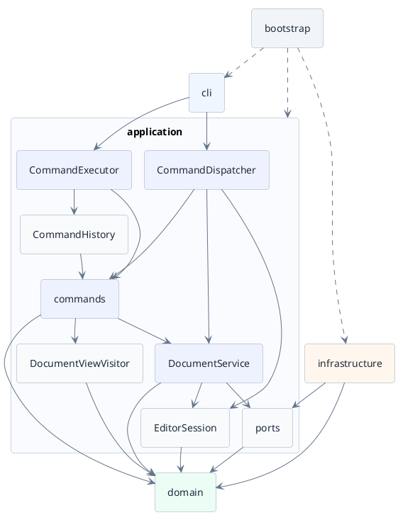

# Lab1 Phase 1：SVG 编辑器（CLI）项目文档

需求依据：[`phase_cli_1.md`](../phase_cli_1.md)。本文件按作业要求位于 `doc/README.md`，作为完整项目文档。

当前阶段：完成需求整理、基础资源初始化及架构修订；业务代码尚未实现。下文“拟定”“计划”均不代表已完成；实现结果、验收记录与自查结论留空，待取得实际证据后填写。

## 1. 架构方案

### 1.1 目标与范围

本阶段用 TypeScript 实现 CLI SVG 编辑器，支持 `rect`、`circle`、`ellipse`、`line`、`text`、`g` 六种图形，以及文档读写、图形编辑、查询和撤销重做。

采用面向对象设计：字段封装、类层次与多态，一类一文件，文件名与类名一致。GUI、宿主集成、动态插件和 `box` 留待后续阶段。以下内容是设计方案，尚未实现。

### 1.2 模块职责

系统分为交互、应用、领域和基础设施四层，由启动模块组装。

| 目录 | 职责 | 主要对象 |
|---|---|---|
| `src/cli/` | 输入分词、委托命令创建与执行、结果排版 | Repl、CommandLineParser、OutputFormatter |
| `src/application/` | 命令调度、会话、历史、文档操作及只读查询 | CommandDispatcher、CommandExecutor、EditorSession、CommandHistory、DocumentService、DocumentViewVisitor |
| `src/application/commands/` | 命令契约和具体命令，保存参数及撤销记录 | Command、UndoableCommand、MoveCommand、GroupCommand 等 |
| `src/application/ports/` | 应用需要的外部读写接口 | DocumentStore |
| `src/domain/` | 几何、样式、文档树、唯一 id 和局部变更 | SvgDocument、Shape、六种图形、ShapeFactory、ShapeVisitor、ChangeSet |
| `src/infrastructure/` | SVG 编解码和文件读写 | SvgReader、SvgWriteVisitor、SvgDocumentStore |
| `src/bootstrap/` | 创建对象、注入依赖、注册命令、启动 CLI | Main |
| `tests/` | 单元测试、IO 集成、CLI 回放和 SVG 样本 | |
| `doc/` | 项目说明、工作记忆和验收记录 | |

会话、历史、文档协调和查询访问者直接放在 application 下。Command、UndoableCommand 和命令结果类型放在 commands 中；CommandDescriptor 与分发器同目录，查询模型与访问者同目录，各类仍独立成文件。

编辑命令直接以 SvgDocument 为接收者，查询命令委托 DocumentViewVisitor。DocumentService 负责初始化、读取、保存及画布调整的会话协调，通过 DocumentStore 使用 IO，不管理历史。TreeFormatter、ShowFormatter 放在 cli 中，只排版查询模型。

### 1.3 模块关系

图按从上到下展开，保留 application 内部职责。箭头指向被依赖方，虚线表示启动组装；完整规则见 1.7。执行器和历史只依赖 commands 中的命令契约，不依赖具体命令类。



### 1.4 设计模式

| 模式或手段 | 如何使用 | 主要取舍 | 实现证据 |
|---|---|---|---|
| Command | 每条请求封装为命令；执行器统一调用，历史保存可撤销命令 | 命令只转发，业务规则留在接收者中 | |
| Composite | Shape 统一叶子与容器操作，Group 递归处理子节点 | 树的防环、父级和 id 约束仍须显式校验 | |
| Visitor | accept 负责遍历，访问者负责查询投影和 SVG 输出 | 适合当前固定的六种类型；新增图形需要复评访问协议 | |
| Adapter | SvgDocumentStore 实现 DocumentStore，封装文件 API 和 SVG 编解码 | 应用和领域不接触外部库类型 | |
| Iterator | 用标准 Iterable 顺序访问子节点 | 隐藏可变集合，不另建遍历框架 | |
| 集中创建 | CommandDispatcher 注册内置命令；ShapeFactory 创建图形 | 静态装配，不实现动态加载；图形创建属于简单工厂 | |

#### 图形与文档

SvgDocument 统一管理树结构和 id 索引，提供创建、删除、分组、解组、重新挂接和排序操作。根画布不是第七种可创建图形。

Shape 封装 id、样式和几何行为。叶子修改自身，Group 递归执行 move/scale。结构原语采用透明式接口：叶子明确拒绝添加子节点，Group 提供实现；写入口限制在文档协作内部，避免绕过索引和防环校验。删除叶子和删除子树都由文档统一处理。

普通 g 的 set 修改自身允许的样式，保留 SVG 继承，不覆盖子孙显式样式。scale 同乘位置和尺寸，不能只改大小。

#### 遍历与展示

ShapeVisitor 提供各叶子的 visit 方法，以及 enterGroup/leaveGroup。Group.accept 按“进入、递归、离开”遍历；访问者不再自行递归。enterGroup 可跳过子树，使 show 只读取目标本身。

DocumentViewVisitor 生成只读查询模型，SvgWriteVisitor 生成 SVG。访问者只读必要属性，不获取可写字段。Iterable 隐藏有序子节点集合；遍历期间不修改结构，先收集变更再提交。

### 1.5 命令执行

各对象分工如下：

| 对象 | 负责什么 |
|---|---|
| CommandLineParser | 通用分词，保留引号语义和颜色参数 |
| CommandDispatcher | 按命令名查描述符，校验参数并创建命令 |
| CommandExecutor | 串行执行，等待 IO 完成，协调历史 |
| 具体 Command | 保存参数、接收者和撤销句柄，调用接收者 |
| SvgDocument / Shape | 完成图形操作与校验 |
| DocumentService | 协调会话替换、保存路径及 IO |
| DocumentViewVisitor | 生成只读查询结果 |
| CommandHistory | 维护两个栈及历史屏障 |

以 `move r1 30 0` 为例：

```text
分词 → 创建 MoveCommand → 执行器调用 execute()
     → SvgDocument.move() → Shape
     → 提交局部变更和历史 → CLI 显示结果
```

命令不得直接改坐标、操作子节点集合、维护索引或读写文件。编辑命令绑定当前 SvgDocument，调用其受控操作；查询命令委托独立的查询访问者。分发器从 EditorSession 取得当前文档后创建命令，每次查询使用新的访问者，避免残留状态。初始化和读写命令绑定 DocumentService；文档替换成功后清理旧历史，避免旧命令误用新文档。undo/redo 由统一命令入口交给执行器，不进入编辑历史，也不反向依赖具体命令。

按名字分派只保留两处：CommandDispatcher 和 ShapeFactory，作为后续扩展时的重构点。SVG 导入复用同一图形工厂，不再增加标签 switch。

Main 在启动时注册内置 CommandDescriptor，包含名称、参数解码、帮助和创建方法。重复名称在接收命令前报错；help 与描述符同源。执行类别由命令表达，canvas 查询与修改的历史行为分别处理。

### 1.6 撤销重做与失败处理

历史保存命令及封装的局部 ChangeSet，不为每个小编辑复制整份文档。

| 操作 | 撤销需要保留的信息 |
|---|---|
| create | 新节点、父级和插入位置 |
| delete | 完整子树、原父级、原位置和索引恢复信息 |
| move / scale | 受影响节点修改前后的精确几何值 |
| set | 新旧值，以及原属性是否存在 |
| group / ungroup / addto | 相关父级的有序子列表、父引用、容器和索引变化 |
| front / back | 父级、原位置和目标位置 |

首次执行保存记录，undo 恢复旧状态，redo 应用已保存的新状态。重做不重新分配 id，不覆盖首次记录；恢复几何使用旧值，避免反向计算的浮点误差。记录绑定文档，文档替换后清除旧历史。一次复杂树编辑仍是一个撤销单元。

| 请求 | 成功后的历史变化 |
|---|---|
| 新编辑 | 压入 undo，清空 redo，解除屏障 |
| undo / redo | 恢复成功后，才把命令转移到另一栈 |
| 查询、无参 canvas | 不变 |
| init / read / save / 修改 canvas | 清除旧历史，禁止撤销重做，直到下一次编辑成功 |

**失败命令保持全部状态不变**，包括文档、默认路径、两个历史栈和屏障。

领域操作先准备局部候选状态，完成数值、id、父级和顺序校验，再同步提交。多节点运算必须先全部算完并检查有限数值，避免部分节点已改、后续节点报错。提交前准备好变更记录和目标历史；提交中不做 IO 或外部回调。仍可能失败的步骤必须能够完整回滚，并通过失败注入验证。

read 先构造和校验候选文档，成功后再替换。save 先写同目录临时文件，成功替换目标后才更新路径和历史；失败保留原文件及会话，并清理临时文件。文件替换能力需按实际平台验证，进程崩溃和内存耗尽不属于可恢复命令错误的保证范围。

导入时先检查所有显式 id，再为缺 id 节点分配不冲突的“标签名+序号”；警告仅在整次读取成功后返回。SVG 读写正确处理命名空间和转义，省略的 fill/stroke 不补写。

### 1.7 依赖规则

| 模块或对象 | 允许依赖 |
|---|---|
| domain | 标准能力和本模块 |
| commands 中的命令契约 | 标准能力及必要的内部结果类型 |
| 具体命令 | 命令契约、SvgDocument、领域变更记录、DocumentService、DocumentViewVisitor |
| EditorSession、ports | domain |
| DocumentService | EditorSession、ports、domain |
| DocumentViewVisitor | domain 及其只读查询模型 |
| CommandHistory | Command / UndoableCommand 契约 |
| CommandExecutor | 命令契约、CommandHistory |
| CommandDispatcher | 命令创建器、EditorSession、DocumentService |
| cli | Dispatcher、Executor、命令结果及查询模型、终端能力 |
| infrastructure | ports、domain 及必要的 IO/XML 库 |
| bootstrap | 需要组装的生产模块 |
| tests | 被测模块和测试工具 |

目录合并不改变职责和依赖方向。领域不依赖终端、文件系统、XML 库或宿主 SDK；命令不依赖执行器和历史；DocumentService 不依赖具体命令或历史。命令契约、会话和查询模型都是内部协作约定，不构成对外 SDK。

禁止跨层循环依赖。commands 中的契约与具体实现分文件导入，执行器和历史不通过导出全部命令的桶文件访问契约。领域 Visitor 与图形的类型引用优先使用 type-only，避免运行时循环加载。生产代码不依赖测试，其他生产模块不依赖 bootstrap。

### 1.8 变化点与扩展取舍

| 可能的变化 | 当前安排与原因 | 后续工作 |
|---|---|---|
| 新命令 | 集中注册，复用执行器和历史 | 增加接收者行为、薄命令、描述符和测试 |
| GUI | 命令与领域独立于终端，查询与排版分离 | 增加界面、命中检测、预览和提交后通知 |
| 宿主集成 | DocumentStore 隔离存储，不绑定 SDK | 在 VS Code、DeepSeek harness 等实际宿主中适配入口、存储和生命周期 |
| 统一应用接口 | **不预留 EditorApi**：目前只有 CLI，其他入口需求未定，固定协议缺少验收依据且增加维护成本 | 第二个实际入口出现后，再提取共享接口和契约测试 |
| 动态插件 | 内置命令静态注册、图形集中创建，不实现加载器 | 明确版本、名称冲突、卸载和历史引用的存活规则 |
| 新图形与 box | 当前仅六种类型；Composite 支持组合 | box 可复用基础子树，但仍需属性和序列化契约；任意新类型需复评 Visitor |
| XML 库和存储 | 外部能力通过接口注入 | 替换适配器并验证契约 |
| 历史规模 | 记录随受影响范围增长，不复制无关节点 | 有性能证据后再设计容量与持久化 |

宿主集成和编辑器加载插件是两件事：前者把已有能力接到另一个应用，后者扩展编辑器自身。两者都不在本阶段实现，也不预先固定通信协议。

未来 GUI 的选择、视口和拖拽预览留在界面层。一次拖拽默认在释放时提交一次命令，取消不改文档；多视图在提交后通知，监听失败不回滚成功编辑。宿主接入时需明确由谁管理撤销，避免两套历史失配；关闭和重载经应用流程处理。跨进程传输届时定义请求和结果，不序列化持有接收者的命令对象。

### 1.9 实现前需明确的问题

- 跨父容器 group 的新父级、插入位置和顺序基准。
- 外部 SVG 的 transform、viewBox、不支持元素和属性的处理范围；不能静默丢失数据。
- text 缩放的几何范围。
- save 显式路径是否成为后续默认路径，无文档时 help 是否可用。
- 示例元素数量与实际树不一致时，以实际节点为准并记录差异。

## 2. 与 AI 协作的过程记录

保留影响架构和交付的关键讨论。目前仅完成设计，尚无业务代码和测试结果。

| 日期 | 讨论与问题 | 决策 |
|---|---|---|
| 2026-10-16 | 整理需求并初始化项目 | 拟定分层架构，采用 Command 和 Composite；实现证据与验收结论留空 |
| 2026-10-25 | 文档位置需要符合提交要求 | 将完整 README 从根目录移至 doc/，同步链接和协作约定 |
| 2026-10-25 | AI 初始建议每次编辑保存全文快照，小编辑也会复制无关数据 | 改为命令加局部变更记录，明确接收者、执行器及失败原子性的职责 |
| 2026-10-25 | 考虑新命令、GUI 和宿主集成时，AI 提前预留了统一 EditorApi | 用户明确当前不需要；保留命令、领域和 IO 分层，待实际新增入口后再提取接口，并说明当前不留的原因 |
| 2026-10-25 | 应用层目录过细，编辑和查询 Service 主要是转发 | 压平单类目录，命令直接委托领域或访问者；保留文档读写协调、独立执行器、历史及存储接口，并同步依赖图 |

## 3. 实现后的一致性自查

### 3.1 模块划分

| 计划模块 | 实际目录与证据 | 是否一致 | 偏差及修订记录 |
|---|---|---|---|
| `cli` | | | |
| `application` / `commands` / `ports` | | | |
| `domain` | | | |
| `infrastructure` | | | |
| `bootstrap` | | | |

模块划分自查结论：

### 3.2 依赖方向

| 抽样模块或文件 | 实际依赖 | 对照规则 | 待处理项或修正证据 |
|---|---|---|---|

依赖方向自查结论：

## 4. 功能完整性与质量保证手段

### 4.1 功能验收矩阵（计划）

| 需求范围 | 计划验证内容 | 实际用例与执行结果 |
|---|---|---|
| REPL 与输入 | `svg>`、逐行回放、整行注释、保留颜色参数中的 `#`、双引号与含空格文本、浮点数、统一错误前缀与成功摘要 | |
| 文档命令 | `init` 默认/指定尺寸，`read`，`save` 指定/沿用路径，`canvas` 查询/修改，无文档错误，文件读写失败 | |
| 六种图形 | 全部创建参数、默认样式属性省略、唯一且大小写敏感的 id、未知类型（包括 `box`）、`in` 成功及两种目标错误 | |
| 编辑与属性 | `delete`、`move`、`scale`、`set` 的叶子与容器行为，白名单、文本、非正缩放及非法参数 | |
| 树结构 | `group`、`ungroup`、`addto`、`front`、`back`；祖先冲突、防环、子树删除、同级顺序、根级解组拒绝 | |
| 显示 | `tree` 全文档/子树、内联几何属性、`show` 的父级与属性、`help` 覆盖全部命令与语法 | |
| 撤销重做 | 每条编辑一个单元、复杂树修改完整恢复、新编辑清 redo、显示不入栈、文档操作屏障、失败无副作用 | |
| SVG 读写 | 缺 id 警告与碰撞规避、重复 id、XML 转义、命名空间、保存再读语义等价、失败不替换当前文档 | |
| 完整场景 | 需求第 6 节典型会话与 6.1 版本 A 流程图，保存后浏览器预览；版本 B 不在本阶段验收 | |

功能完整性结论：

### 4.2 质量保证计划

按 Test → Code → Refactor 推进：先明确行为，再实现和重构。计划分层验证：

| 层次 | 重点 |
|---|---|
| 领域 | 几何、属性白名单、树结构和 id 不变量 |
| 命令 | 执行、撤销、重做后状态精确一致 |
| 执行器 | 串行执行、成功入栈、失败不变、redo 清空和历史屏障 |
| 读写 | 替身模拟失败；临时目录验证真实读写与替换；保存再读比较模型语义 |
| CLI | 分词、帮助、错误格式及典型会话回放 |
| 架构 | 字段封装、一类一文件、两处分派、依赖方向和模式职责 |

复杂编辑比较父级、顺序、属性存在性、几何和 id 索引，不只比较输出。测试可生成完整观察快照用于断言，但生产历史仍只保存局部变更。失败用例同时检查文档、路径和历史；返回模型的修改不能影响领域。

实现后运行严格类型检查、自动化测试及浏览器 SVG 预览，并记录真实结果。GUI 和宿主能力在对应阶段另行验收。开发保持分步提交，最终验收后才创建 `final` tag。

### 4.3 实际验证记录

| 日期 | 验证命令或方法 | 结果 | 证据与剩余问题 |
|---|---|---|---|

代码质量结论：
