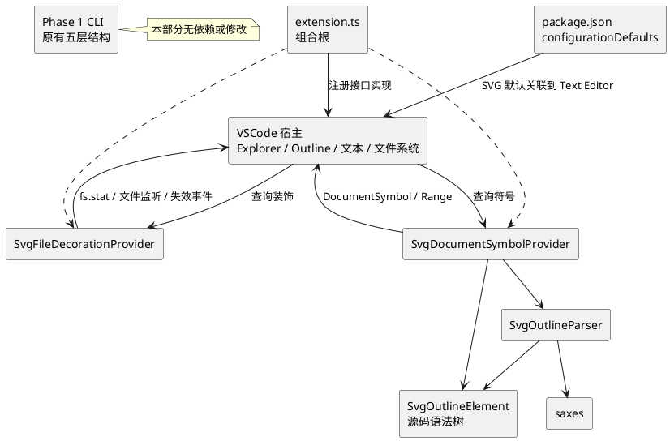
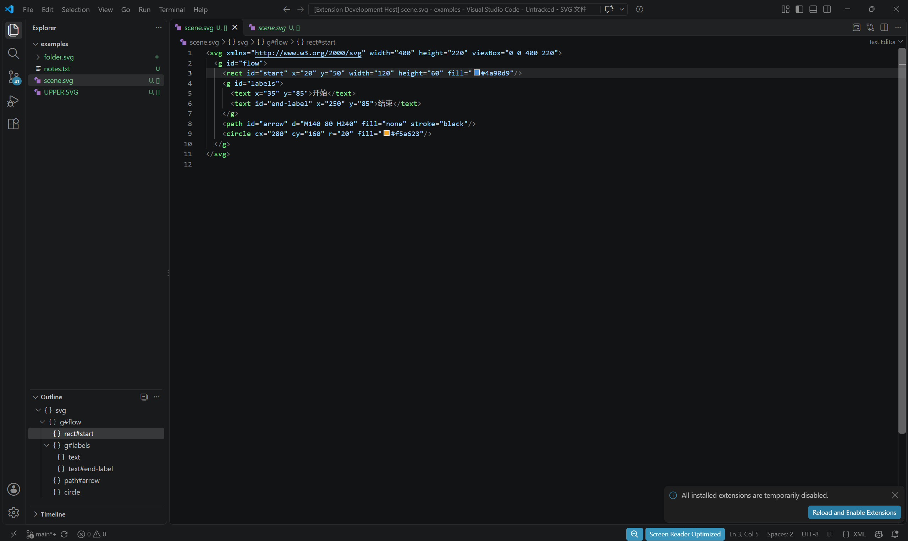
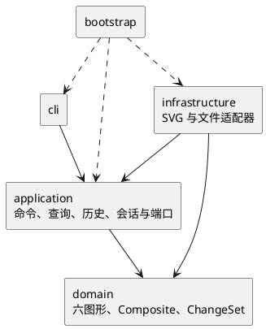
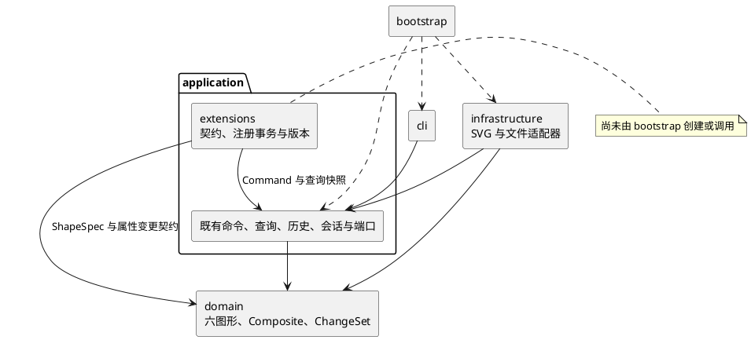
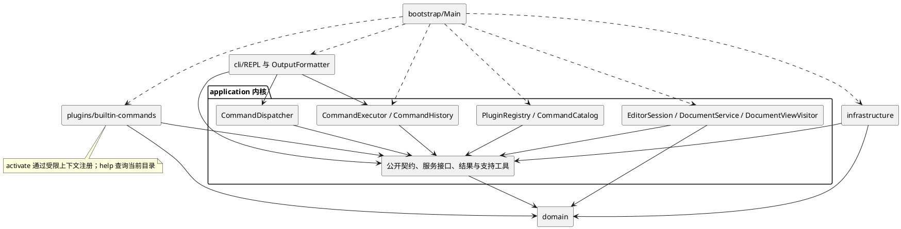

# PJ1 Phase 2 实验报告

课程要求：[Phase 1](phase_cli_1.md) · [Phase 2](phase_cli_2.md)。原 Phase 1 实验报告已独立保存在 [README_PHASE1.md](README_PHASE1.md)，其中设计和验收结论保留其历史含义。

## 1. 当前范围与架构

已实现第一部分 VSCode 插件实践：Explorer 文件标记、原生 Outline 元素层级与源码定位、编辑更新及异常 XML 恢复。第二部分按逐步检查、逐步提交的顺序推进：第 1 步注册基础已提交为 9e56bf1；当前完成第 2 步内置命令注册化与动态 help，等待用户检查，详见第 7 节。默认 CLI 已通过注册表分发命令；图形创建、属性设置、树标签和 SVG 读写的插件化仍待后续节点，领域 Composite 与历史语义保持原有行为。

| 目录或类 | 实际职责 |
|---|---|
| `extensions/svg-tools/src/extension.ts` | 激活入口与组合根；注册两个 provider，向 context 转交资源生命周期 |
| `extensions/svg-tools/package.json` | 声明激活、入口与 SVG → Text Editor 的默认编辑器关联；用户显式设置仍可覆盖同名默认项 |
| `SvgFileDecorationProvider` | 检查 SVG 后缀并通过宿主文件系统确认文件类型；提供 `[]`；文件变化后通知宿主重新查询 |
| `SvgDocumentSymbolProvider` | 将文本语法树适配为原生 DocumentSymbol，包括整体范围、定位范围和子符号；使用显式工作栈防止深层转换溢出 |
| `outline/SvgOutlineParser` | 使用 saxes 解析任意 SVG 元素、缺省 id 和源码偏移；不完整 XML 返回空树 |
| `outline/SvgOutlineElement` | 封装标签显示名、UTF-16 范围及嵌套元素；叶子和容器统一遍历 |
| `tests/`、`tests/host/` | 独立 Vitest 行为测试、真实 VSCode 扩展宿主集成测试 |
| `scripts/build-extension.mjs` | 将扩展及 saxes 打包为独立 CJS 文件，排除宿主提供的 vscode 模块 |
| `scripts/test-extension-host.mjs` | 使用 test-electron 启动隔离宿主；清理经绝对路径检查的专用临时配置 |



这是第一部分新增独立宿主插件后的实际依赖图，不是第二部分 CLI 的重构前后对比图。CLI 第 1 步的阶段记录见第 6 节，第 2 步当前扩展点清单与依赖对比见第 7 节；双装配、配置格式、dir 模式分析和 Git 历史指标随对应步骤实现后填写。

## 2. VSCode 与扩展的协作

VSCode 负责文件树、文档缓冲区、编辑事件调度、大纲 UI、折叠、排序和点击跳转。扩展不自行绘制树视图：激活时调用 `window.registerFileDecorationProvider` 与 `languages.registerDocumentSymbolProvider`；随后由 VSCode 在需要显示装饰或更新符号时调用 provider，形成控制反转。

0.1.1 根据用户实测补充编辑器选择边界：Outline 导航将资源与源码范围交给宿主，宿主仍会解析该资源的默认编辑器。扩展通过 manifest 的 `contributes.configurationDefaults` 为 `workbench.editorAssociations` 提供 `*.[sS][vV][gG] → default`，使 SVG 的默认导航目标为 Text Editor。没有注册自己的点击处理器，也不在运行期写用户或工作区配置；仍可显式选择 Image Preview。依据：[配置默认值贡献点](https://code.visualstudio.com/api/references/contribution-points#contributes.configurationDefaults)、[当前宿主的源码编辑器导航适配](https://github.com/microsoft/vscode/blob/661626d0e72f97806550790a98fb87116c9db825/src/vs/workbench/contrib/codeEditor/browser/outline/documentSymbolEditor.ts)。

文件标记需要在仅浏览 Explorer 时也可用，因此通过 `onStartupFinished` 激活，不要求先打开 SVG。文件装饰依据 URI.path 的大小写无关 `.svg` 后缀和 `workspace.fs.stat` 的 File 位判定；目录、未知类型、已删除文件不标记，支持宿主文件系统提供的文件。目录名即使以 `.svg` 结尾也无标记。符号链接仅在宿主 stat 同时报告 File 位时标记，不递归访问目标；装饰不向父目录传播。

文档选择器按 `**/*.[sS][vV][gG]` 匹配，不依赖用户将 SVG 关联为 XML 还是其他语言。每次查询读取当前未保存文本，重新构造候选树；无缓存和额外文档状态。XML 解析失败或含 DOCTYPE 时返回空树，之后的合法输入可恢复。没有完整 SVG 规范校验，也不读取外部实体。支持任意合法元素名，包括 defs、path、带命名空间前缀的元素；不补 id。

DocumentSymbol.range 包含整个元素，selectionRange 仅包含开标签的 `<标签名`。saxes 的 UTF-16 偏移交给 TextDocument.positionAt 转为行列，保留 CRLF、多行属性和 emoji 的正确位置。所有元素使用相同 SymbolKind.Object，避免按图形标签再次分派。监听器、事件发送器和 provider 注册返回的 Disposable 都归 context.subscriptions，扩展卸载时由宿主释放。

接口及调度规则依据 [VSCode API](https://code.visualstudio.com/api/references/vscode-api)；宿主测试使用官方 [Testing Extensions](https://code.visualstudio.com/api/working-with-extensions/testing-extension) 的 test-electron 入口。

## 3. 模式分析与 Phase 1 复用评估

| 对象与调用关系 | 模式对应与差异 |
|---|---|
| VSCode 在 Explorer 原有文件项目上叠加 provider 返回的 FileDecoration | 效果类似 Decorator 的附加职责，原文件名和文件内容不变；但 provider 没有包装同一 Component 接口、没有持有并转发被装饰对象。它是宿主的装饰扩展点，不是经典 Decorator 的对象包装链，也不是 TypeScript 的 `@decorator` |
| SvgFileDecorationProvider 实现 FileDecorationProvider，组合宿主 fs.stat | 把 URI 和文件类型检查适配为宿主要求的 badge/tooltip，存在 Adapter 的接口转换作用；它没有包装 Phase 1 图形对象，不能把其名字里的 Decoration 直接当成完整 GoF Decorator 结构 |
| SvgDocumentSymbolProvider 组合 SvgOutlineParser，将 SvgOutlineElement 转成 DocumentSymbol/Range | 典型对象 Adapter：VSCode 为 Client，DocumentSymbolProvider 为 Target，源码解析器为 Adaptee，provider 为 Adapter；转换包含数据结构、层级和坐标协议 |
| SvgOutlineElement 自身含同类子节点；映射按同一入口递归处理全部元素 | 采用统一树结构表达容器与叶子，没有按标签区分树操作；它是源码语法树，不承担图形编辑领域行为 |

Phase 1 的 SvgTreeParser 严格限制六种类型和属性、画布尺寸及命名空间；SvgReader 会分配缺失 id、验证唯一性并创建可编辑领域文档。Outline 需要保留外部源文件的任意元素及缺省 id，且必须知道精确源码范围。直接复用会拒绝普通 path/defs，改变节点显示语义，也缺少定位信息。因此只复用已选用的 saxes 库和严格错误处理经验，不让扩展依赖 infrastructure 或 domain。

Phase 1 的 Shape/Group Composite、ShapeVisitor、ShapeCollector 和 DocumentViewVisitor 遍历的是已构建的六类型领域树，不保存原始文本、注释或范围。它们适用于未来图形编辑集成，不能替代本部分的源码大纲遍历。现有 Command 与 undo/redo 继续用于 CLI；本扩展仅查询，文本编辑和撤销由 VSCode 负责，无需引入第二套编辑历史或空转发命令。

实际决策见 [ADR-001：独立源码大纲与宿主边界](adr/001-vscode-source-outline.md)。

## 4. 安装、运行与测试

需要 Node.js ≥24、仓库固定版本的 pnpm、桌面 VSCode ≥1.96。

在仓库根目录执行：

```sh
pnpm install --frozen-lockfile
pnpm run check:extension
```

用 VSCode 打开整个仓库，按 **F5**，选择 **SVG Tools: Extension Host**。preLaunchTask 自动构建并打开示例目录。打开 `scene.svg`，展开 Explorer 下的 **Outline**，依次展开 svg、g#flow、g#labels；点击 rect#start 应定位到源码第 3 行。修改 id 后等待大纲刷新，删去闭合标签时应暂时清空，再撤销编辑检查恢复。对照 notes.txt 和 folder.svg 目录均无 `[]`。若没有标记，确认 Explorer 的文件装饰徽章已启用；其他装饰扩展可能争用徽章，调试配置禁用了其他用户扩展。

打包安装：

```sh
pnpm run build:extension
pnpm run package:extension
code --install-extension extensions/svg-tools/dist/svg-tools-0.1.1.vsix --force
```

也可通过 VSCode 扩展视图的 **Install from VSIX...** 选择该文件。打包仅包含 manifest、扩展说明、示例和 bundle，不要求最终用户安装本仓库的 Node 依赖。

升级 0.1.1 后执行 **Developer: Reload Window**，对已打开的 SVG 选择 **Reopen Editor With... → Text Editor**。若仍跳往 Image Preview，检查用户与工作区的 `workbench.editorAssociations`：把已有的 SVG 关联项改为 `default`，保留其他文件类型的项。没有相关项时可添加：

```json
"workbench.editorAssociations": {
  "*.[sS][vV][gG]": "default"
}
```

临时以 Text Editor 重开一次只能保证当前编辑器是源码，不能替代默认关联设置；这是原先安装步骤遗漏的边界。

```sh
pnpm run test:extension             # 解析、provider、注册与资源释放
pnpm run typecheck:extension        # 与真实 VSCode 类型契约校验
pnpm run test:extension:host        # 真实扩展宿主，默认下载 VSCode
pnpm run check                     # CLI 回归及扩展检查，不含启动 GUI
```

本地已有 VSCode 时，可在 PowerShell 指定可执行文件以避免下载：

```powershell
$env:VSCODE_EXECUTABLE_PATH = "$env:LOCALAPPDATA\Programs\Microsoft VS Code\Code.exe"
pnpm run test:extension:host
```

不同安装位置应替换该路径。测试使用独立临时用户与扩展目录，并在结束后清理；不使用日常 VSCode 配置。真实宿主测试比单元测试更慢，需要图形桌面。

## 5. TDD、过程与验证证据

1. 在实现前先写 outline-parser.test.ts，执行后因 SvgOutlineParser 缺失失败；再补充文件、目录、取消、异常、注册和释放测试，执行后两个测试文件均因生产模块缺失失败。
2. 实现解析器、语法节点和两个 provider。首轮 18 项中 17 项通过；定位测试期望少算了 `g` 开标签的一位，经对照原字符串修正；同时补齐扩展 package.json 的 type=module，使严格类型检查可用。发布产物仍为宿主可加载的 .cjs。
3. 编写真实宿主测试并执行。第一轮已通过嵌套、缺 id 和范围检查，失败于无效 XML 的空结果断言：VSCode 将 provider 的空数组规范化为 undefined。测试入口统一规范化为空列表，保留正常符号和恢复断言，不改变生产行为。另一轮发现测试自己执行 WorkspaceEdit 后，恢复同样文本不等于恢复宿主的 dirty 历史；改在查询后、主动编辑前验证 clean，并在装饰查询前后比较文本、版本及 dirty，而不把测试主动编辑归因于扩展。
4. 架构复查先补充 8000 层嵌套用例，实际失败为 Maximum call stack size exceeded；将符号递归转换改为显式工作栈后通过。新增架构测试是实现后的守卫，不将其追述为测试先行开发。
5. VSIX 首次打包因 vsce 不支持 --cwd 失败；核对已安装工具的 API，改用支持 cwd 的 createVSIX，成功打包并通过隔离目录安装验证。默认打包扫描和依赖声明仍生效，没有改成手写 ZIP 或依赖用户的 node_modules。
6. 用户实测发现点击 Outline 会转到 Image Preview。此前测试使用 showTextDocument 强制源码，验证了范围但遗漏了宿主编辑器解析。先新增 vscode.open（带符号 selection）的真实宿主回归，旧清单下按预期失败为“symbol navigation must open source text, not Image Preview”；随后用 configurationDefaults 声明 SVG 默认 Text Editor，回归通过。该测试覆盖导航依赖的编辑器解析路径，未将 API 回归宣称为实际鼠标点击验收；手工截图安排不变。

### 5.1 自动检查结果

| 实际执行 | 结果 |
|---|---|
| `pnpm install --frozen-lockfile` | 锁文件安装通过；esbuild 的构建脚本显式启用，未使用的 vsce-sign 构建脚本显式禁用 |
| `pnpm run check` | CLI 31 个文件、97 项通过；扩展 3 个文件、21 项通过；两部分严格类型检查和生产构建通过 |
| `pnpm run test:extension:host`（本地 VSCode 1.148.0） | 真实注册、嵌套/无 id、源码范围与编辑器解析、从显式图片预览返回源码、大写 SVG 导航、未保存编辑、无效 XML 恢复、真实文件/目录及文件状态不变通过 |
| `pnpm run package:extension` | 生成可安装 VSIX；包含独立 bundle、说明、许可声明和示例，不包含宿主测试代码 |
| 隔离目录的 `code --install-extension ... --force` 与 `--list-extensions --show-versions` | 修复版安装成功，列出 `svg-editor-lab.svg-tools@0.1.1`；未向用户现有扩展目录安装 |

宿主结果由脚本生成：[host-results.json](vscode/evidence/host-results.json)。完整检查输出见 [validation.txt](vscode/evidence/validation.txt)。尚未验证最低版本 1.96、其他操作系统、远程工作区或其他用户扩展的组合效果，不将本地宿主结果外推为这些环境的验收。

Outline 导航修复的先失败、后通过输出见 [outline-navigation.txt](vscode/evidence/outline-navigation.txt)。测试只调用公开导航 API，不替代手工鼠标点击和截图验收。

### 5.2 界面观察与演示

实现前在原有 VSCode 中展开 Markdown 原生 Outline，观察标题的嵌套层级；点击 `### A.2 SVG 大纲` 后编辑器跳到第 23 行第 1 列，确认原生视图承担定位行为。


用户提供的实际运行截图如下，同一张图展示文件标记、大纲层级与源码定位状态。



*图 5.1：Extension Development Host 中，Explorer 的 scene.svg、UPPER.SVG 右侧显示 `[]`，notes.txt 与 folder.svg 目录没有该标记；`U` 是 Git 的未跟踪状态，与扩展的 `[]` 标记不同。原生 Outline 展示 svg → g#flow 及嵌套的 g#labels，带 id 的节点显示 rect#start、text#end-label，无 id 的节点显示 text、circle。选中 rect#start 时，右侧为 Text Editor，源码第 3 行高亮，状态栏显示 Ln 3, Col 5，展示了回到源码的定位结果。此图为用户提供的项目实际运行证据，与课程要求中的两张示意图区分。*

复现与进一步手工检查步骤：

1. 在仓库根目录按第 4 节步骤启动 F5 的 Extension Development Host，打开 scene.svg，展开 Explorer 和 Outline。确认 scene.svg、UPPER.SVG 右侧有 `[]`，notes.txt 与 folder.svg 目录没有该标记。
2. 在 Outline 展开 svg → g#flow → g#labels，确认无 id 的 text 显示为 text；点击 rect#start，检查源码第 3 行及状态栏定位。
3. 将 start 改为 start-v2，等待 Outline 更新；临时删去闭合标签使 XML 不完整，确认大纲清空且宿主可继续编辑；撤销输入后检查大纲恢复。此过程不要保存对示例的临时修改。

| 手工验收项 | 结果 | 截图 |
|---|---|---|
| SVG 文件标记、普通文件/目录排除 | 图中 scene.svg、UPPER.SVG 显示 `[]`，notes.txt、folder.svg 目录不显示 | 图 5.1 |
| 大纲层级、缺 id 元素显示 | 图中展示嵌套分组、带 id 节点及无 id 的 text、circle | 图 5.1 |
| 源码定位结果 | rect#start 被选中，Text Editor 第 3 行高亮，状态栏为 Ln 3, Col 5 | 图 5.1 |
| 输入更新、不完整 XML 与恢复 | | |

静态截图展示上述界面状态；输入更新、异常恢复及文件内容/名称不变的自动化验证见第 5.1 节。尚未提供的手工动态过程结果继续留空。

### 5.3 架构自查

生产类保持一类一文件、字段封装；组合根仅注册和组装，文件装饰、源码解析和符号适配各有单一职责。syntax 模型不依赖 VSCode/XML 库，扩展不依赖 CLI 各层，也没有向 domain 引入终端、文件系统或 XML 语法。全部标签通过同一元素结构和适配入口处理，无 switch(tag) 或按六图形名重复分派。应用展示文案未进入 CLI application，扩展 tooltip 属于宿主展示适配层。

原 CLI 的 Command 与 Composite 契约、历史和失败原子性由 97 项回归继续覆盖；本扩展不执行编辑命令，不触碰文档历史。语法解析的候选树只在成功后返回，失败不保留部分结果或旧缓存；文件不存在、目录、取消和异步 stat 失败均返回无装饰。文档更新由宿主调度，监听器和注册句柄由 context 管理。实际发现并修复的当前结构风险是递归符号转换的栈溢出；测试协议与包工具接口问题也已同轮修正。

自动守卫覆盖类文件名、CLI 隔离、分派位置和语法模型依赖；行为测试独立于 VSCode 运行，真实宿主测试单独启动，二者不互相冒充。第一部分实现时没有提前引入第二部分协议；第二部分随后按第 6 节记录的独立步骤推进。

导航修复自查：编辑器选择属于宿主集成与 manifest 默认配置职责，不将其混入 SvgOutlineParser 或 DocumentSymbol 数据；没有监听 active editor 反复抢焦点、修改所有 SVG 的 URI、替换原生 Outline 或增加无业务含义的 Command。类与字段、层级依赖、分派位置、Command/Composite 原契约、领域输入/展示隔离、异常与状态边界保持原状；回归使用真实宿主的编辑器解析，修正了原测试强制源码导致的覆盖盲区。

## 6. CLI 重构第 1 步：公共契约与事务式注册

本节记录在 0b711d7 之后新增的实际工作，不改写 Phase 1 原设计。用户授权按 12 个节点顺序推进，每步完成后由用户检查代码与提交；本步不暂存、提交或推送。当前仅实现独立注册层，尚未达到课程第 7 节“框架可扩展”节点，也未交付四个正式业务插件。

### 6.1 当前目录、接口与调用边界

新增 [src/application/extensions](../src/application/extensions/)：契约、注册版本、单次激活暂存区与事务协调器均位于应用层；不改动 domain、cli、infrastructure 或 bootstrap 的运行代码，也不新增依赖。

| 类型 | 当前职责与实际调用位置 |
|---|---|
| [PluginRegistry](../src/application/extensions/PluginRegistry.ts) | activate 排队；runActivation 调用插件，成功后一次发布四类表，失败后保留旧版本 |
| [PluginRegistration](../src/application/extensions/PluginRegistration.ts) | context 只暴露四个 register 方法；stage 生成暂存版本，finish 检查失败标志并关闭，close 禁止迟到写入 |
| [PluginContributions](../src/application/extensions/PluginContributions.ts) | 封装四类同版本注册表；withShape/withCommand/withDecorator/withAttribute 返回新版本 |
| [ExtensionRegistry](../src/application/extensions/ExtensionRegistry.ts) | with 校验名称、重复与必需方法；get 返回注册项，values 返回按注册顺序排列的冻结数组 |

扩展点清单的“CLI 业务调用位置”暂时留空；本步实际调用来自 [plugin-registration.test.ts](../tests/application/plugin-registration.test.ts)，不把测试调用当成已经迁移生产链路。

| 扩展点 | 当前职责及接口 | 注册调用位置 | 本步已有实现 | CLI 业务调用位置 |
|---|---|---|---|---|
| [ShapeProvider](../src/application/extensions/ShapeProvider.ts) | name、syntaxes、createSpec 返回类型化 ShapeSpec；领域构造与 SVG 协作者尚未迁移 | PluginRegistration.context.registerShape → PluginContributions.withShape | RegistrationTestShape（测试） | |
| [Command](../src/application/commands/contracts/Command.ts) / [CommandContribution](../src/application/extensions/CommandContribution.ts) | 复用原 Command 执行契约；贡献 name、syntaxes、create | PluginRegistration.context.registerCommand → PluginContributions.withCommand | RegistrationTestCommand（测试）；原命令尚未注册化 | |
| [TreeDecorator](../src/application/extensions/TreeDecorator.ts) | labels 接收 TreeLineContext 的查询快照，返回标签；无 shape 表示画布行 | PluginRegistration.context.registerDecorator → PluginContributions.withDecorator | RegistrationTestDecorator（测试） | |
| [AttributeHandler](../src/application/extensions/AttributeHandler.ts) | handles 只读匹配；prepare 通过受限 AttributeEditContext 准备 ChangeSet，PreparedAttributeEdit.readValue 读取语义结果 | PluginRegistration.context.registerAttribute → PluginContributions.withAttribute | RegistrationTestAttribute（测试） | |

未注册时，四类表的 values 均为空，get 返回 undefined。注册层不安装隐式插件、不提供兜底业务分派；当前默认 CLI 仍通过原装配提供 Phase 1 命令与六图形，因此可选扩展未接入时原行为继续存在。处理器未命中的默认属性规则、无装饰器时的统一渲染、内置 provider 装配和新命令的未知错误，将在对应迁移步骤验证。

同类别同名拒绝整批，错误为 duplicate registration: category/name；跨类别同名允许。名称为空或含空白字符时为 invalid registration name: category；缺少必需方法时为 invalid registration: category/name (missing method: method)。激活异常封装为 plugin failed to activate: name (reason) 并保留 cause。上下文关闭后调用为 plugin registration context is closed。当前均为语义异常，不直接打印；终端 error: 输出与继续启动由第 8 步装配适配层接入。

注册异常即使被插件捕获，该批次也无法提交；未捕获的同步异常、异步拒绝亦丢弃整个暂存版本。注册事务保证成员关系原子性，不代替未来属性编辑事务。接口的只读和 prepare 契约也不等于本步已经验证任意第三方处理器的业务行为。

### 6.2 重构前后依赖图与实际取舍

重构前是 0b711d7 中 CLI 的层级概览；内部 Command、Composite 与存储端口的细节保留于 [Phase 1 报告](README_PHASE1.md)。



本步后的实际依赖如下。extensions 仍未接入生产启动链路；新增的测试插件独立验证注册与调用，不在图中伪装为已装配业务插件。



具体决策见 [ADR-002：注册按插件暂存，成功后原子发布](adr/002-plugin-registration-transactions.md)。本步复用 Command 与 ChangeSet，没有平行执行体系；以持久化注册版本替代全局表的写后删除，公开上下文与内部暂存区分离。属性和图形接口只定义本步可验证的初版边界，后续由实际迁移完善；没有把内部 ShapeTree、可变文档、XML 类型或 CLI token 传入领域。

### 6.3 测试先行、架构复查与验证

先新增注册测试及五个类实现的测试插件协作者，运行指定测试，实际因 PluginRegistry.js 模块缺失失败；随后实现契约和事务后 16 项通过。架构复查补充名称中的内部空白、缺少必需方法、已有对象身份保持等测试和校验；这些补充不追述为初轮测试先行。

复查发现旧守卫仍禁止出现 ShapeProvider，与 Phase 2 当前任务冲突；仅移除该名字禁令，保留 EditorApi 和尚未开始的 Box 实现边界，新增注册层禁止依赖宿主、内部文档树和外部 IO 的守卫。检查了类与字段封装、职责、依赖方向、分派、Command/Composite 契约、领域输入、应用展示、异常原子性、扩展点和测试组织。本步代码没有新增按图形名的分支、可写领域数据袋或终端输出；失败激活不修改已发布版本，既有编辑和历史仍由原链路回归覆盖。

| 实际执行 | 结果 |
|---|---|
| 实现前：pnpm exec vitest run tests/application/plugin-registration.test.ts | 按预期因生产模块缺失失败 |
| pnpm exec vitest run tests/application/plugin-registration.test.ts tests/integration/architecture.test.ts | 2 个文件、28 项通过（21 项注册测试、7 项架构守卫） |
| pnpm run typecheck（初版 16 项通过后） | 通过 |
| pnpm run check（最终实现） | CLI 32 个文件、119 项通过；扩展 3 个文件、21 项通过；两部分类型检查与构建通过 |
| 文档链接、代码块、换行与 git diff --check | 26 个本地路径可解析，代码块闭合；本步源码、测试、文档与日志为 UTF-8/LF 并有末尾换行；diff 检查通过 |

完整检查输出保存在 [step-01-check.txt](cli/evidence/step-01-check.txt)。此日志对应本步实际执行，不覆盖第 5 节保留的第一部分历史验收证据；本轮没有重新启动 GUI 宿主或打包 VSIX。

### 6.4 后续节点

用户检查并完成本步提交后，下一步迁移内置命令和动态 help。图形创建、查询与读写、复合结构、属性调用、树装饰、双装配、stats、dir、box 与 modified-star 按已讨论的后续节点推进。配置格式、两种启动步骤、dir 模式映射、其余 ADR、指标与接入零内核差异证据随对应实现填写，当前不预写最终结论。

## 7. CLI 重构第 2 步：内置命令注册化与动态 help

第 6 节保留第 1 步当时的实际状态。本步从干净的 9e56bf1 继续，不重写 Phase 1 设计或旧检查结果。已迁移命令调用链，尚未达到四类扩展全部贯通的框架节点；本步不提交、推送或创建标签。

### 7.1 模块职责与实际调整

| 位置 | 当前职责 |
|---|---|
| [CommandDispatcher](../src/application/CommandDispatcher.ts) | 仅依赖 CommandCatalog 查找贡献并构造 Command；处理缺失名称、未知名称和工厂契约失败；不导入内置命令、插件或帮助实现 |
| [CommandCatalog](../src/application/extensions/CommandCatalog.ts)、[PluginRegistry](../src/application/extensions/PluginRegistry.ts) | 只读查询当前发布的命令及其语法；后续成功注册立即可见，失败批次不进入分发与帮助 |
| [src/plugins/builtin-commands](../src/plugins/builtin-commands/) | 独立内置命令源码包；BuiltinCommandsPlugin 按原顺序注册 19 个名字，BuiltinCommandContribution 封装稳定的名称、冻结语法和构造行为 |
| `builtin-commands/commands`、`factories`、`specs` | 从 application/commands 迁移的 21 个命令类文件（含重排基类）、3 个参数工厂、6 个图形规格 Builder，共 30 个原有实现文件；树与历史操作仍调用原领域/框架契约 |
| `application/commands` | 保留 Command/UndoableCommand、EditChangeSetCommand、InvalidCommand、结果类型与公共支持工具，移出具体内置命令 |
| [ActiveDocument](../src/application/ports/ActiveDocument.ts)、[DocumentOperations](../src/application/ports/DocumentOperations.ts)、[HistoryController](../src/application/commands/contracts/HistoryController.ts)、[DocumentQuery](../src/application/queries/DocumentQuery.ts) | 公开服务接口，分别限定当前文档获取、文档用例、撤销重做和查询投影；既有类实现接口，插件不导入会话、文档服务、历史或查询 Visitor 的具体实现 |
| [PresentedCommandResult](../src/application/commands/results/PresentedCommandResult.ts)、[CommandPresenter](../src/application/commands/contracts/CommandPresenter.ts) | 通用插件结果与展示协作契约；无需向内核 Visitor 逐项增加 stats、dir 等结果类型 |
| [Main.run](../src/bootstrap/Main.ts) | 创建同一套服务与历史，等待内置插件事务激活成功，再启动注册分发器和 REPL |

这是对第 1 步初版接口的实际接入：CommandContribution 不只是测试接口，默认运行也消费其 create；没有另建命令执行器或历史。插件入口使用类及类实例，避免为 19 条定义新增重复薄类；参数解码仍保留在有实际职责的工厂中。

内置插件放在 src/plugins 下，以保留 tsconfig 的 src 根与 dist/bootstrap/entry.js 启动路径。包内 package.json 声明名称与 contributes.commands，源码入口提供默认导出；当前由 Main 显式构造并通过 PluginRegistry.activate 注册，没有实现动态模块解析、包发布、配置装配或 manifest 运行期校验。图形 Builder 目前随创建命令移动，仍是六类型集中映射，后续第 3 步再由 ShapeProvider 接管，不将它追述为已插件化图形。

### 7.2 当前扩展点清单与依赖规则

| 接口 | 内核调用位置 | 当前实现 | 禁用可选扩展时 | 契约错误 |
|---|---|---|---|---|
| CommandContribution / Command | CommandDispatcher.create → contribution.create；CommandExecutor.run → command.execute | BuiltinCommandsPlugin 的 19 条内置贡献；ProbeContribution 为测试验证插件 | 默认装配仍提供 Phase 1 命令和六图形；未注册命令返回 error: unknown command: name，且不出现在 help 中 | 重名/非法语法整批拒绝；构造抛错或返回非 Command 时转为 error: command failed 并保留 cause |
| CommandCatalog | BuiltinCommandsPlugin.createHelp → commandSyntaxes；CommandDispatcher.create → findCommand | PluginRegistry | help 只展示已成功发布的贡献，顺序为注册顺序 | 当前语法须为非空单行字符串数组；失败注册不污染目录 |
| ShapeProvider | | RegistrationTestShape（测试） | 尚未接管默认图形装配 | 注册层校验沿用第 6 节，业务返回值校验待迁移 |
| TreeDecorator | | RegistrationTestDecorator（测试） | 当前 tree 继续使用原排版 | 注册层校验沿用第 6 节，装饰组合待迁移 |
| AttributeHandler | | RegistrationTestAttribute（测试） | 当前 set 继续使用原白名单和属性槽 | 注册层校验沿用第 6 节，选择、冲突和业务事务待迁移 |

依赖规则延续 domain 只依赖 domain、application 不依赖 plugins/cli/infrastructure、cli 不依赖 plugins、infrastructure 不依赖 plugins。新增 plugins 层只能访问本包、公开应用接口/结果/支持工具及领域公开抽象，禁止访问其他插件、内部 ShapeTree/Planner/ShapeFactory、具体 EditorSession/DocumentService/CommandHistory/DocumentViewVisitor 或宿主模块；由 bootstrap 依赖并装配两侧。

当前公开应用 API 范围由 [architecture.test.ts](../tests/integration/architecture.test.ts) 的 ARCH-P2-02 列出：commands/contracts、commands/results、commands/support、EditChangeSetCommand、InvalidCommand、Plugin/PluginContext、CommandContribution/CommandCatalog、ActiveDocument/DocumentOperations/LoadedDocument 与 DocumentQuery。其他应用实现不因 TS export 就自动成为插件 API。

第 6.2 节展示重构前和第 1 步的状态；本步实际依赖如下：



### 7.3 通用结果、失败原子性与 ADR

新增插件可以返回自己的语义值，并由独立 CommandPresenter 提供具体文案。PresentedCommandResult 在构造时调用一次 presenter，缓存字符串；OutputFormatter.visitPresented 只返回缓存内容，不执行可能抛错的插件展示代码。内核和应用公共结果中没有 probe、stats 或 dir 文案。

这与最初讨论的“在 CLI 排版时再委托 presenter”有实际调整：若展示在编辑已经入历史之后才失败，会留下成功修改却无结果的窗口。编辑插件使用 EditChangeSetCommand，并在 createResult 内构造 PresentedCommandResult，展示失败即可复用已有回滚；undo/redo 构造结果失败时同样恢复状态和历史。该保证不代表可以补偿插件绕过契约自行执行的外部副作用。决策及取舍见 [ADR-003](adr/003-command-registration-and-presentation.md)。

### 7.4 实际验证与架构自查

先写新增集成测试，运行时因 PresentedCommandResult.js 缺失失败；实现后，注册分发、动态帮助、原命令构造与架构测试 4 个文件/18 项通过，严格类型检查通过。随后补充 undo/redo 展示失败、非法 Command 返回值与插件 API 白名单守卫，再执行针对性和全量检查。

| 实际执行 | 结果 |
|---|---|
| 实现前指定 registered-commands.test.ts | 按预期因通用结果模块缺失失败 |
| pnpm exec vitest run tests/integration/registered-commands.test.ts tests/integration/architecture.test.ts | 2 文件/18 项通过（10 项新增集成测试、8 项架构守卫） |
| pnpm run check | CLI 33 文件/130 测试、扩展 3 文件/21 测试通过；两部分类型检查与构建通过 |
| 真实构建产物与 final 样本逐字节比较 | 7 个输入/预期/SVG 样本未变；两份会话的 stdout 与两份保存 SVG 均与 final 标签中的样本逐字节一致，共 11 项比较通过 |
| 本地链接、文本格式与 git diff --check | 6 份文档的 58 个本地路径与代码块检查通过，本步文本均为 UTF-8/LF、含末尾换行；diff 检查通过 |

证据：[完整检查日志](cli/evidence/step-02-check.txt)、[final 基线比较](cli/evidence/step-02-baseline.txt)。基线比较使用隔离临时目录，启动当前 dist/bootstrap/entry.js，不规范化输出换行；先从 Git 读取 final 的样本并验证工作样本未改，再比较当前真实输出。临时目录已在确认绝对路径后清理。本轮没有重新启动 GUI 宿主或安装 VSIX。

架构复查覆盖类/字段封装、职责、依赖方向、多态/分派、Command/Composite、领域输入、展示、异常原子性、扩展契约与测试组织。发现并处理：内置实现不应由内核分发器持有；Move/Scale 不应在插件内部默认 new 具体查询 Visitor；动态 help 不能持有旧注册快照；工厂异常不能使 REPL 退出；插件展示失败必须发生在编辑结果构造期。修正后默认装配共享同一历史，公开上下文仍只负责注册，领域层与 XML/终端隔离保持原状。

### 7.5 剩余事项

等待用户检查并完成第 2 步提交后，继续第 3 步图形创建注册化。后续步骤仍须实现图形/查询/SVG 扩展、复合结构保护、属性选择与事务、树装饰和生命周期，再接入加载器、目录端口与装配能力，最后独立接入 stats、dir、box 与 modified-star。未实现配置装配或宣称接入零内核差异判据已经通过，未生成最终指标或 p2 标签。
