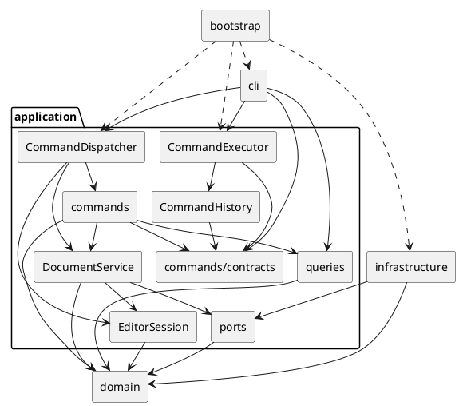

# PJ1 Phase 1：SVG 编辑器（CLI）

本项目使用 TypeScript 实现命令行 SVG 编辑器，支持 `rect`、`circle`、`ellipse`、`line`、`text`、`g` 六种内置图形，以及文档读写、树结构编辑、属性修改、查询和撤销重做。

运行环境为 Node.js 24 或更高版本，包管理器版本由 `package.json` 的 `packageManager` 固定。安装、构建和启动：

```sh
pnpm install --frozen-lockfile
pnpm run build
pnpm run cli
```

进入后输入 `help` 查看完整语法。简单示例：

```text
init 800 600
create g scene
create rect r1 20 30 120 60 #4a90d9 in scene
create text t1 35 65 "开始" in scene
move scene 40 0
undo
tree
show r1
save demo.svg
```

保存的 SVG 可直接用浏览器打开。

## 1. 架构方案

### 1.1 模块划分

| 目录 | 职责 | 主要对象 |
|---|---|---|
| `src/cli/` | 输入分词、REPL、结果排版 | CommandLineParser、Repl、OutputFormatter、ShapeFormatter、TreeFormatter、ShowFormatter |
| `src/application/` | 命令分发、串行执行、会话、历史及文档协调 | CommandDispatcher、CommandExecutor、EditorSession、CommandHistory、DocumentService |
| `src/application/commands/` | 保存请求参数，调用接收者，组织执行及撤销结果 | CreateShapeCommand、MoveShapeCommand、EditChangeSetCommand 等具体命令 |
| `commands/contracts/`、`results/`、`support/` | 命令契约、语义结果、执行守卫与参数支持 | Command、UndoableCommand、CommandResult、CommandExecutionGuard |
| `commands/factories/`、`specs/` | 解码命令参数，构造类型化规格及编辑请求 | CreateShapeCommandFactory、DocumentCommandFactory、ShapeEditCommandFactory、六种 SpecBuilder |
| `src/application/queries/` | 从领域对象生成不可变查询快照 | DocumentViewVisitor、DocumentView、ShapeSnapshot、GeometrySnapshot |
| `src/application/ports/` | 定义应用所需存储契约与导入结果 | DocumentStore、LoadedDocument、ImportedShapeId |
| `src/domain/document/` | 文档聚合、画布尺寸、树结构及 id 不变量、结构变更规划 | SvgDocument、CanvasSize、ShapeTree、ShapeStructurePlanner |
| `src/domain/shapes/` | 叶子与容器行为、样式、属性及精确局部变更 | Shape、ContainerShape、Group、五种叶子图形、ShapeStyle、ShapeAttributeSlot |
| `src/domain/specs/`、`visitor/` | 类型化创建规格与领域遍历协议 | ShapeSpec 及六种规格、ShapeVisitor、ShapeCollector |
| `src/domain/` | 图形集中创建、通用变更契约及失败补偿 | ShapeFactory、ChangeSet、CompositeChangeSet、ChangeSetExecutor、DomainError |
| `src/infrastructure/` | SVG 解析、序列化和文件存储适配 | SvgTreeParser、SvgElementFactory、SvgReader、SvgWriteVisitor、SvgDocumentStore |
| `src/bootstrap/` | 组装依赖并启动 CLI | Main、entry |
| `tests/` | 领域、应用、CLI、集成与端到端测试及样本 | 分层测试、support、fixtures |
| `scripts/`、`doc/` | 构建清理、项目说明及验收证据 | clean.mjs、本文件、验收记录 |

`commands/` 下的子目录均属于应用层。各层不通过 barrel 文件隐藏依赖；生产类独立成文件。`SvgDocument` 持有私有树和规划器，对外提供受控领域操作；图形仅开放只读父子查询。

#### 1.1.1 模块关系图

箭头指向被依赖的模块，虚线表示启动装配。命令执行器与历史只依赖命令契约，不依赖具体命令类。



### 1.2 设计模式的选择

| 模式或手段 | 实际落地 | 选择理由与取舍 |
|---|---|---|
| Command | `Command` 统一执行入口；`UndoableCommand` 增加撤销、重做；具体命令持有参数及接收者；`CommandExecutor` 协调执行和历史 | 请求可独立测试，执行入口统一；命令不直接修改树集合、维护索引或读写文件 |
| Composite | `Shape` 统一几何和属性契约，`ContainerShape`、`Group` 组合子图形；move/scale 递归准备后代变更 | 叶子和容器通过相同命令操作；删除及重挂接由文档聚合统一维护不变量，普通组的 set 仅修改自身样式 |
| Visitor | `ShapeVisitor`、各图形的 `accept`、`DocumentViewVisitor`、`SvgWriteVisitor`、`ShapeCollector` | 遍历与查询、序列化职责分离；Group 控制递归，访问者可跳过子树。适合固定六类型，新增类型需复评协议 |
| Adapter | `SvgDocumentStore` 实现 `DocumentStore` | 文件系统及 XML 库留在基础设施，应用通过端口使用存储 |
| Iterator | 根节点和容器通过 `Iterable<Shape>` 提供有序遍历 | 隐藏可变集合，避免暴露 children 的增删入口 |
| 简单工厂与静态注册 | 命令定义表、`ShapeFactory`、读取方向的 `SvgElementFactory` | 名字分派集中；帮助与命令语法同源，不提前实现动态加载 |

按名字分派限定为命令分发和图形工厂两类位置：`CommandDispatcher` 负责命令名，`CreateShapeCommandFactory` 负责 create 子命令规格，`ShapeFactory` 负责类型化规格到图形类，`SvgElementFactory` 负责 SVG 标签到解析节点。它们是后续增加命令或图形时的集中重构点；领域操作和 CLI 排版不散布图形名称 switch。

#### 1.2.1 命令执行与职责边界

```text
输入行 → 分词 → CommandDispatcher 创建命令
      → CommandExecutor 串行执行
      → 具体命令调用 SvgDocument / DocumentService
      → 返回语义结果 → CLI 排版
```

命令参数工厂将 token 解码为类型化创建规格、数值或属性更新，领域不解析外部命令语法。预期错误通过执行守卫转换为失败结果，未知异常由执行器输出统一错误并保留内部 cause。应用结果只表达语义，`error:` 前缀、属性布局和树形字符由 CLI 负责。

编辑命令绑定文档并保存局部变更。查询访问者捕获几何、样式、父级和子节点，返回复制并冻结的快照；CLI 不持有可写领域对象。`DocumentService` 协调会话和 IO，不管理历史；执行器在文档命令成功后建立历史屏障。

#### 1.2.2 撤销重做与失败原子性

一条成功且有状态变化的编辑命令构成一个 undo 单元。历史保存命令及局部 `ChangeSet`，不复制无关文档数据。几何保存精确前后值；属性保留原值及是否存在；结构变更保留节点、父级和位置。redo 重用首次记录，撤销不依赖反向浮点运算。

| 操作 | 历史行为 |
|---|---|
| 新的有效编辑 | 压入 undo，清空 redo，解除屏障 |
| undo / redo | 状态恢复及结果构造成功后迁移命令 |
| 查询、无参数 canvas | 不改变历史 |
| init / read / save / 修改 canvas | 成功后清空旧历史并建立屏障 |
| 成功但无状态变化的编辑 | 不入历史，保留 redo 和原屏障状态 |
| 失败命令 | 文档、默认路径、历史栈和屏障保持不变 |

领域先准备并校验所有候选变更，再同步提交。多节点操作不边计算边修改；组合变更逆序撤销，提交或恢复失败时补偿已完成的动作。结果构造失败同样恢复状态。

read 先解析、构造并验证候选文档，成功后替换会话；警告只在读取成功后返回。save 先写同目录临时文件，再 rename 替换目标，成功后更新路径。真实文件故障注入验证了临时文件创建、部分写入及替换失败时的保留与清理行为；不将此等同于进程崩溃或断电恢复保证。

### 1.3 依赖方向规则

| 模块或对象 | 允许依赖 | 理由 |
|---|---|---|
| domain | 标准能力和领域内部模块 | 领域规则不绑定终端、文件系统或 XML 库 |
| commands/contracts | 必要的内部命令与结果契约 | 供执行器和历史稳定调用 |
| commands/results | 命令契约、只读查询模型 | 传递语义结果，隔离展示 |
| commands/support | 契约、结果、领域错误和端口错误 | 集中处理命令边界 |
| 具体命令 | 契约、结果、支持类、domain、DocumentService、查询模型 | 编排用例，业务校验留在接收者 |
| EditorSession、ports | domain | 保存领域状态，定义存储需求 |
| DocumentService | EditorSession、ports、domain | 协调文档，不接触具体存储实现或历史 |
| queries | domain 和查询模型 | 生成只读投影 |
| CommandExecutor、CommandHistory | 命令契约；执行器另依赖历史 | 避免与具体命令互相依赖 |
| CommandDispatcher | 命令及创建器、会话、文档协调与历史、查询协作者 | 集中装配命令请求 |
| cli | 应用入口、结果契约、查询模型、终端能力 | 只承担交互和排版 |
| infrastructure | ports、domain、必要的 Node.js/XML 库 | 实现外部能力适配 |
| bootstrap | 所需生产模块 | 集中创建对象和注入依赖 |
| tests | 被测模块和测试工具 | 测试依赖生产，生产不依赖测试 |

禁止反向依赖和运行期循环；其他生产模块不得依赖 bootstrap。仅用于类型的导入使用 `import type`，避免图形与 Visitor 的类型引用形成运行期加载环。

### 1.4 变化点假设

| 变化点 | 已保留的边界或不预留的原因 |
|---|---|
| 新命令 | 定义表统一注册语法和创建逻辑，可复用执行器、历史及局部变更基类 |
| 新图形、box 与插件 | 工厂集中创建、Composite 支持组合；当前不加载插件，任意新类型需复评 Visitor、序列化和历史契约，不承诺零内核改动 |
| GUI | 命令、领域和只读投影可复用；命中检测、拖拽预览及视口尚无实际需求，不预设协议 |
| 宿主集成 | 存储端口可适配宿主；历史归属和通信方式由实际宿主决定，当前不绑定 SDK |
| 统一 EditorApi | 当前仅 CLI，第二入口未定；不提前增加转发层、通用请求和订阅协议 |

#### 1.4.1 已明确的实现边界

- **命令扩展**：当前命令通过统一定义表注册，具体命令使用共同的执行与历史机制。以后增加命令时，仍需明确参数、校验规则和撤销行为，并补充相应测试；定义表不负责动态加载外部命令。
- **图形与插件**：本阶段只实现 rect、circle、ellipse、line、text、g 六种内置图形，不实现 box 或插件加载。现有 Visitor 接口按这六种图形设计；新增类型时，需要同时检查图形创建、查询展示、SVG 读写和撤销重做，不能保证只增加一个图形类就能完成扩展。
- **图形界面**：当前仅提供 CLI，尚未实现鼠标选择、拖拽、缩放视图等交互。将来开发 GUI 时，可以复用命令、领域对象和只读查询结果，但界面交互及其与命令的衔接仍需单独设计。
- **宿主集成**：当前以独立命令行程序运行，未接入 VS Code 或其他宿主。存储端口隔离了文件操作；接入宿主时，仍需确定通信方式、保存方式，以及撤销重做由宿主还是编辑器管理，当前不绑定具体 SDK。
- **统一应用接口**：目前没有第二种调用入口，因此不实现通用 EditorApi、请求协议或事件订阅机制。待 GUI 或宿主集成提出具体需求后，再根据多个入口实际共用的能力提取接口。

## 2. 过程记录

以下记录关键、有代表性的讨论与迭代，区分早期方案、问题确认和后续修正；完整阶段记录见 [工作记忆](WORK_MEMORY.md)。

| 讨论或发现 | 确认方式 | 处理与取舍 |
|---|---|---|
| 早期方案为未来 GUI、宿主集成引入 EditorApi，以及只做转发的 EditService、QueryService；用户指出当前只有 CLI，未来入口未定 | 审查接口用途与各层实际职责，确认这些抽象尚无独立规则或验收依据 | 不提前固定通用协议；具体命令直接委托领域，DocumentService 保留文档与 IO 协调。继续采用 Command、Composite 和存储端口，第二入口出现后再评估应用接口 |
| 领域仍解析 CLI 数字文本，直接使用 Number 会把空字符串当成 0 | 检查数值转换路径，并以空数字、十六进制回归确认外部语法与领域校验混在一起 | 用类型化 Spec、ShapeAttributeUpdate 隔离外部语法，数值解码集中在命令参数层；[封装与输入测试](../tests/domain/shape-mutation-architecture.test.ts) 检查类型化输入契约 |
| 树集合虽被隐藏，公开的 symbol 写协议仍可能绕过 id 索引和防环约束 | 检查父子关系、节点顺序和索引的写入位置，核对公开 API 与结构变更测试 | 删除公开树写协议，由 SvgDocument 持有私有 ShapeTree；ShapeStructurePlanner 负责校验并准备变更，图形只开放父子关系查询 |
| AI 生成的查询 View、展示 Visitor、Description 和多个薄命令工厂存在重复包装；用户要求按讨论方案简化 | 对照调用链与各类实际行为，确认部分工厂只是转发构造，多套模型反复保存同一份数据 | 统一查询快照与 ShapeFormatter，移除薄工厂和 TreeEditCommand，复用 CompositeChangeSet；保留三类有实际参数解码职责的命令工厂 |
| 简化后自查发现 readonly 不能阻止运行期修改，show 容器也可能过度遍历后代 | [查询快照回归](../tests/application/query-snapshot.test.ts) 检查旧快照隔离、集合冻结、明细不访问子节点及后续全树查询 | 防御性复制并冻结集合、数值元组和快照；明细查询采用独立的非递归 Visitor 实例，避免查询模式影响后续操作 |
| 集成验收发现容器 move 的 undo 恢复了几何，但摘要仍显示正向位移 | 两个失败回归确认问题，再对照课程典型会话与流程图，定位到 MoveShapeCommand 的结果构造 | undo 语义结果携带反向位移，redo 保留正向位移；精确旧值恢复机制不变，CLI 只负责排版。[课程会话回放](../tests/e2e/course-acceptance.test.ts) 比较实际输出与预期结果 |
| 验收讨论要求把“保存失败不改变状态”落实到旧文件、路径和历史，而不只检查错误返回 | [保存失败测试](../tests/integration/save-failure-atomicity.test.ts) 在真实旧文件上注入临时文件创建、部分写入和 rename 失败，核对内容、清理、文档、路径及历史 | 将旧文件保留、临时文件清理、失败后 redo 可用等要求固定为回归；保证范围限于已验证的文件操作失败，不扩大为断电或进程崩溃恢复能力 |

## 3. 一致性自查

### 3.1 模块划分是否一致

五个主要模块与分层方案一致，内部协作有以下调整；未将这些实现变化描述为原方案一直如此。

| 原方案或中间设计 | 实际实现 | 调整理由 |
|---|---|---|
| SvgDocument 直接承担树维护与结构规划 | 聚合根持有私有 ShapeTree 和 ShapeStructurePlanner | 分离索引维护和候选规划，收紧树写入口 |
| 容器通过透明式结构接口操作子节点 | 图形仅查询父子关系，结构写操作由文档聚合负责 | 避免叶子/容器公开写入口绕过文档不变量 |
| 六类查询 View 和查询展示 Visitor | DocumentView、ShapeSnapshot、GeometrySnapshot、一个投影 Visitor，CLI 共用 Formatter | 减少平行层次和重复分派，查询结果仍为不可变语义数据 |
| 多个薄命令工厂与树编辑中间基类 | 保留三类有解码职责的工厂；简单命令直接由 Dispatcher 创建，结构命令复用 EditChangeSetCommand | 去除无独立行为的转发层 |
| 树、属性、几何分别维护组合变更集合 | CompositeChangeSet 统一组合契约，GeometryChangeSet 保留便利构造 | 去除重复提交和补偿逻辑 |


### 3.2 依赖方向是否符合规则

| 抽查对象 | 实际依赖与结论 |
|---|---|
| SvgDocument、ContainerShape | 仅依赖领域协作者；无终端、文件系统、XML 或 CLI token |
| CommandHistory、CommandExecutor | 通过命令契约执行及迁移历史，不依赖具体编辑命令 |
| MoveShapeCommand、EditChangeSetCommand | 委托领域变更并构造语义结果；不维护树集合、不拼接 CLI 文案 |
| DocumentViewVisitor、ShapeFormatter | 投影依赖领域，排版依赖应用快照；无反向调用 |
| SvgDocumentStore、SvgElementFactory | 基础设施依赖存储端口和领域，外部 XML 类型未进入领域 |
| Main | 集中组装具体实现，无其他生产模块反向导入 bootstrap |

自动架构守卫检查领域隔离、层级依赖、运行期循环、一类一文件、字段封装、集中分派及命令变更入口。结合源码抽查，未发现当前范围内待修正的依赖违规。领域校验仍封装于对象，查询快照仅传递不可变结果。

## 4. 质量保证手段

### 4.1 开发中的 TDD 流程

开发按功能分步推进，在已有记录可确认的功能实现和缺陷修复中采用 TDD（测试驱动开发），按照“先失败、再通过、再重构”的顺序迭代：

1. **先写测试并确认失败**：从需求中选取一个可验证的行为，写明输入、预期结果和状态约束，再运行测试，确认失败源于功能缺失或待修复问题。编辑命令除检查输出外，还检查图形状态及历史；失败场景检查文档、路径和历史是否保持不变。
2. **实现并使测试通过**：实现当前行为所需的代码，先运行相关测试；若暴露出新的边界问题，补充回归用例并继续修正，直到预期行为与状态检查都通过。
3. **重构并保持测试通过**：检查类的职责、封装、依赖方向和 Command、Composite 契约，消除重复或不合适的抽象，再运行相关测试、完整回归、类型检查和构建，确认结构调整没有改变既有行为。

### 4.2 验证方法与覆盖

采用分层测试和问题驱动回归。

| 验证层级 | 主要覆盖 |
|---|---|
| 领域单元 | 六种图形、样式与几何校验、Composite、防环、顺序、局部变更及补偿 |
| 应用与命令 | 参数构造、串行执行、查询快照隔离、有效编辑入栈、undo/redo、屏障和失败不迁移历史 |
| CLI | 分词、双引号、颜色、数值、单行错误、help、tree/show 与交互/管道提示符 |
| IO 集成 | 严格读取、命名空间、缺 id、XML 转义、默认路径、round-trip、真实文件故障注入 |
| 端到端 | 构建生产入口并启动 Node CLI，逐字比较需求典型会话与版本 A 流程图的输出和 SVG |
| 架构守卫 | 依赖方向、循环、字段封装、一类一文件、Command 变更入口及分派位置 |
| 浏览器观察 | Edge 无头渲染并实际查看两个 SVG 的几何、颜色、文字与布局 |

失败用例统一检查文档、默认路径、undo/redo 和屏障不变；读取失败不输出部分警告。测试按 domain、application、cli、integration、e2e 和 support 组织，具体需求映射见 [测试清单](../tests/README.md)。

### 4.3 实际结果与复现

严格类型检查通过；自动化套件共 **31 个测试文件、97 个测试通过**；清理后的生产构建通过。测试清单共 140 项：137 项通过、3 项因 box/插件不在范围内标为 N/A。（清单项与自动化测试不是一一对应关系，不把 137 项写成独立测试数量。）

在仓库根目录可运行：

```sh
pnpm run check
```

#### 手工回放

作业要求的两份完整运行实例已整理到 [`doc/manual_test/`](manual_test/)：
读取了已有的`other.svg`，分别运行`flowchart.txt`和`typical.txt`得到了`flowchart.svg`和`demo.svg`. 经验证，结果正确。