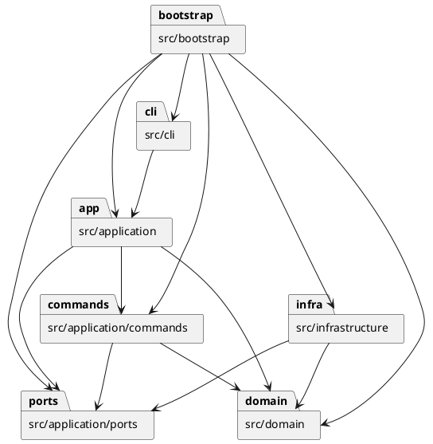

# Lab1 Phase 1：SVG 编辑器（CLI）项目文档

需求依据：[`phase_cli_1.md`](../phase_cli_1.md)。本文件按作业要求位于 `doc/README.md`，作为完整项目文档。

当前阶段：完成需求整理、架构方案与仓库基础资源初始化；业务代码尚未实现。下文“拟定”“计划”均不代表已完成；实现结果、验收记录与自查结论留空，待取得实际证据后填写。

## 1. 架构方案

### 1.1 目标与阶段边界

采用 TypeScript 和面向对象实现命令行 SVG 编辑器：类层次、多态、字段封装、一类一文件，类文件名与类名一致。内核支持 `rect`、`circle`、`ellipse`、`line`、`text`、`g` 六种类型。

本阶段覆盖文档操作、图形编辑、结构与属性显示、撤销重做、SVG 读写。`box`、插件加载以及 GUI 不在本阶段实现；`create box` 按未知类型报错。

### 1.2 模块划分（拟定）

| 目录 | 职责与拟定主要对象 |
|---|---|
| `src/cli/` | `Repl`、`CommandLineParser`、输出格式器；逐行输入、双引号参数、注释、提示符、错误和结果展示，不直接修改模型 |
| `src/application/` | `EditorSession`、`CommandDispatcher`、`CommandHistory`；组织当前文档、保存路径、历史状态及命令执行流程 |
| `src/application/commands/` | `Command` / `UndoableCommand` 及各命令类；将命令封装为对象，区分编辑、查询、文档操作，协调校验与执行 |
| `src/application/ports/` | `DocumentStore` 等外部能力接口；定义应用需要的文档读写能力，不暴露文件系统或 XML 库对象 |
| `src/domain/` | `SvgDocument`、抽象 `Shape`、六种具体图形及 `ShapeFactory`；封装几何、样式、树结构、唯一 id、父子关系与快照 |
| `src/infrastructure/` | `SvgDocumentStore`、SVG 解析与序列化类；文件系统和 XML 适配，导入缺 id 分配及警告收集 |
| `src/bootstrap/` | 创建对象并注入依赖、注册命令与图形类型、启动 CLI；作为唯一组装入口 |
| `tests/` | 单元、集成、CLI 回放及 SVG 样本，验证行为与需求对应关系 |
| `doc/` | 完整项目文档 `doc/README.md`、工作记忆及后续验收证据 |

以上是拟定目录，尚未创建业务模块。依赖箭头表示调用方依赖被调用方：

### 1.3 设计模式的选择（拟定）

| 模式 | 选择理由与落地方案 | 代码落地位置及证据 |
|---|---|---|
| Command（必选） | 一条编辑命令对应一个可撤销命令对象；历史管理器维护 undo/redo，查询命令不入栈，文档命令建立历史屏障 | |
| Composite | 抽象 `Shape` 定义统一操作，叶子封装自身几何，`Group` 管理子节点并递归执行；调用方无需按图形标签分派 | |
| Factory | `ShapeFactory` 集中将六种类型名转换为图形对象，创建参数校验由对应创建对象承担 | |
| Memento（辅助 Command） | 编辑前后保存封装的文档快照，恢复层级、顺序、属性及 id 索引；优先保证复杂树编辑可精确撤销，接受本阶段内存开销 | |

按名字分派只允许出现在两处：`CommandDispatcher`（命令名 → 命令实现）与 `ShapeFactory`（类型名 → 图形类/创建器）。两处均列为后续插件化阶段待重构项，当前集中管理；SVG 导入也复用图形工厂，禁止另外引入 `switch(tag)`。树展示、属性展示、序列化所需的类型差异通过多态处理，不通过重复类型判断扩散。

快照由模型负责创建、校验和恢复，不把可变字段暴露为公共数据袋。先在候选状态中完成编辑及约束校验，成功后提交模型和历史变化；失败不修改文档、保存路径、undo/redo 栈或历史屏障。

### 1.4 依赖方向规则

| 模块 | 允许依赖 | 理由 |
|---|---|---|
| `domain` | 语言标准能力及本模块 | 核心图形行为不依赖 CLI、文件系统、XML 库或应用流程 |
| `application/ports` | `domain` | 用领域对象定义外部能力契约 |
| `application/commands` | `domain`、`application/ports`、本模块 | 命令操作模型，通过接口执行 IO；不反向依赖历史管理器 |
| `application`（协调类） | `domain`、命令契约、`application/ports`、本模块 | 协调会话与历史，不直接依赖具体基础设施 |
| `cli` | 应用层公开入口、本模块、终端标准库 | 将文本翻译为请求，展示应用返回的结果与警告 |
| `infrastructure` | `domain`、`application/ports`、本模块、必要的 IO/XML 库 | 实现应用定义的接口，将外部格式转换为模型 |
| `bootstrap` | 所有生产模块 | 集中组装具体实现，业务模块不得反向依赖它 |
| `tests` | 被测模块 | 测试可跨层组织；生产代码不得依赖测试 |

禁止循环依赖。跨模块访问通过明确的公开契约；任何违反上述规则的依赖都必须记录为待处理项，修正代码或说明并修订方案。

### 1.5 关键行为决策（拟定）

- `SvgDocument` 维护大小写敏感的唯一 id 索引及有序树；删除容器包含所有子孙，重新挂接须防止环。外部 SVG 先收集已有 id，再为缺失 id 分配不冲突的“标签名+序号”，成功导入后输出警告。
- `move` / `scale` 通过图形多态执行，容器递归作用于子孙；`scale` 要同乘位置和尺寸，不能只改宽高。`set` 使用各类型白名单；普通 `g` 的样式保留 SVG 继承语义，不擅自引入 `box` 的属性传播行为。
- 新编辑成功后清空 redo；`init`、`read`、`save`、带参数的 `canvas` 成功后清除旧历史并禁止 undo/redo，直至下一次编辑成功。无参数 `canvas` 和显示类命令不改变历史，失败命令保留全部状态。
- `ungroup` 按需求拒绝根级容器；非根级容器的子图形提升到父级并占据原容器位置。`group` 保持相对顺序并拒绝同时选择祖先与其子孙。
- XML 读写隔离在基础设施中，正确处理命名空间、文本和属性转义；不写入省略的可选 `fill` / `stroke`。

需求尚未完全定义的部分，在实现相关功能前确认或明确记录决策：跨父容器 `group` 的新父级及顺序基准、外部 SVG 的 `transform` 与不支持元素处理策略、文本缩放在属性白名单下的边界。不得静默丢弃不支持的 SVG 数据；初期可明确拒绝超出支持范围的输入。需求示例存在元素数量不一致，验收数量以实际树节点为依据并记录差异。

### 1.6 变化点假设

| 预期变化 | 当前预留或明确不预留的内容 |
|---|---|
| 新命令及其他交互入口 | 命令对象与应用入口独立于 REPL，后续入口可复用；暂不做 GUI 或 agent 接口 |
| 新图形及 `box` 插件 | 统一图形契约与集中工厂为扩展边界；本阶段不实现加载器、插件协议或 `box` |
| SVG 库及存储介质 | `DocumentStore` 隔离文件系统和 XML 实现，领域对象不携带第三方 XML 类型 |
| 撤销性能与文档规模 | 历史管理独立于模型；先用快照保证正确性，待性能证据出现后再考虑命令差量或历史容量限制 |
| 显示格式与错误反馈 | 输出格式器集中维护文本；不为本阶段预建多语言系统 |

## 2. 与 AI 协作的过程记录

仅记录实际发生的讨论与决策，不补写尚未发生的代码生成、人工纠错或测试活动。

| 日期 | 输入与讨论 | 决策或产物 | 验证与边界 |
|---|---|---|---|
| 2026-10-16 | 用户要求阅读需求，构建提交文档、项目工作记忆并初始化基础资源，未实现部分留空 | AI 阅读需求与仓库现状，拟定模块划分、Command / Composite / 快照方案，创建本文、工作记忆和仓库配置 | 初始化前仓库只有需求文件，无业务代码；本文不宣称功能完成 |

### 2.1 后续关键讨论与修订记录

| 日期 | AI 建议或生成结果 | 发现的问题与确认依据 | 修正及影响 |
|---|---|---|---|
| 2026-10-16 | 初始完整文档位于 `doc/README.md` | 用户明确要求 README 位于项目根目录 | 将完整文档移至根目录 `README.md`，修正相对链接、协作约定和工作记忆；原路径保留入口，记录课程提交路径要求的差异 |
| 2026-10-25 | 此前完整文档位于根目录 `README.md` | 用户要求 README 按作业要求放至 `doc/` 下；需求第 1.2 节明确提交路径为 `doc/README.md` | 将完整文档移至 `doc/README.md`，修正需求相对链接、协作约定和工作记忆；保留此前迁移记录作为历史 |

## 3. 实现后的一致性自查

### 3.1 模块划分

| 计划模块 | 实际目录与证据 | 是否一致 | 偏差及修订记录 |
|---|---|---|---|
| `cli` | | | |
| `application` / `commands` / `ports` | | | |
| `domain` | | | |
| `infrastructure` | | | |
| `bootstrap` | | | |

模块划分自查结论：

### 3.2 依赖方向

| 抽样模块或文件 | 实际依赖 | 对照规则 | 待处理项或修正证据 |
|---|---|---|---|

依赖方向自查结论：

## 4. 功能完整性与质量保证手段

### 4.1 功能验收矩阵（计划）

| 需求范围 | 计划验证内容 | 实际用例与执行结果 |
|---|---|---|
| REPL 与输入 | `svg>`、逐行回放、整行注释、保留颜色参数中的 `#`、双引号与含空格文本、浮点数、统一错误前缀与成功摘要 | |
| 文档命令 | `init` 默认/指定尺寸，`read`，`save` 指定/沿用路径，`canvas` 查询/修改，无文档错误，文件读写失败 | |
| 六种图形 | 全部创建参数、默认样式属性省略、唯一且大小写敏感的 id、未知类型（包括 `box`）、`in` 成功及两种目标错误 | |
| 编辑与属性 | `delete`、`move`、`scale`、`set` 的叶子与容器行为，白名单、文本、非正缩放及非法参数 | |
| 树结构 | `group`、`ungroup`、`addto`、`front`、`back`；祖先冲突、防环、子树删除、同级顺序、根级解组拒绝 | |
| 显示 | `tree` 全文档/子树、内联几何属性、`show` 的父级与属性、`help` 覆盖全部命令与语法 | |
| 撤销重做 | 每条编辑一个单元、复杂树修改完整恢复、新编辑清 redo、显示不入栈、文档操作屏障、失败无副作用 | |
| SVG 读写 | 缺 id 警告与碰撞规避、重复 id、XML 转义、命名空间、保存再读语义等价、失败不替换当前文档 | |
| 完整场景 | 需求第 6 节典型会话与 6.1 版本 A 流程图，保存后浏览器预览；版本 B 不在本阶段验收 | |

功能完整性结论：

### 4.2 质量保证计划

- 单元测试验证领域不变量、几何运算、属性校验和命令历史；集成测试验证文件读写与失败原子性；CLI 回放验证端到端输出与状态。
- 对复杂编辑比较执行前、执行后、撤销后、重做后的模型快照，覆盖父子关系、节点顺序、全部属性及 id 索引，避免只验证输出字符串。
- SVG round-trip 比较模型语义，不要求 XML 文本字节一致；浏览器预览补充确认几何与文本外观。
- TypeScript 严格类型检查、静态检查与人工审查共同核对字段封装、一类一文件、分派位置及依赖方向；实际工具和脚本在引入时记录。
- 分步 git 提交记录开发过程，推送远程仓库；最终验收完成后、截止时间之前创建并推送 `final` tag。当前不创建提交、远程或最终 tag。

### 4.3 实际验证记录

| 日期 | 验证命令或方法 | 结果 | 证据与剩余问题 |
|---|---|---|---|

代码质量结论：
